# Лабораторная работа № 5. Анализ потребляемой мощности и сети питания в Cadence Voltus

В предыдущей работе вы познакомились с placement, CTS и routing цифрового блока. Теперь необходимо проверить, как построенная сеть питания доставляет ток к ячейкам и какое напряжение они получают. Для анализа можно использовать собственный проект или готовый учебный вариант, предоставленный преподавателем.

**Цель работы** — подготовить модели для анализа питания, рассчитать среднюю потребляемую мощность и статическое падение напряжения, научиться читать карты и отчёты Voltus и сохранять результаты для повторного просмотра.

На «4» предоставляются простой учебный дизайн и полностью готовый floorplan: студент проходит подготовленный маршрут до физической реализации, выполняет анализ питания и объясняет результат. На «5» студент самостоятельно создаёт floorplan по рисунку и сравнивает два варианта питания: подключение шин M1 к верхним боковым шинам через стеки vias и подключение через распределённую сетку. Динамический анализ включён как ознакомительный раздел.

Команды рассчитаны на Voltus 20.10 **Stylus Common UI**. В Makefile приведены настройки для `s13207` и NanGate45. Перед расчётом проверьте файлы проекта, модели и условия анализа. Полный запуск в Voltus ещё предстоит проверить.

**Пример ручного расчёта** использует floorplan 45 нм с нижней подачей питания. Для оценки токов и просадки понадобятся геометрия из Innovus и мощность из отчёта Voltus. [Расчёт сетки питания](#lab5-pdn-calculation).

> **Рабочий черновик.** Базовый маршрут и углублённые пояснения собраны в одном документе. Блоки «Углублённо» и дополнительные эксперименты отмечены для последующего разделения материала.

## Содержание

1. [Назначение анализа](#lab5-purpose)
2. [Основные понятия](#lab5-basics)
   - [Сопротивление распределённой сети](#lab5-extra-resistance)
   - [Допустимое падение напряжения](#lab5-ir-limit)
   - [Активность и мощность переключения](#lab5-extra-activity)
   - [Technology-only и характеризованные PGV](#lab5-extra-pgv)
3. [Расчёт сетки питания блока 45 нм](#lab5-pdn-calculation)
   - [Исходные данные](#lab5-pdn-inputs)
   - [Токи и потери в шинах и полосах](#lab5-pdn-currents)
   - [Подключение M8 к M9](#lab5-pdn-estimate)
   - [Падение вдоль полосы M8](#lab5-pdn-m8)
   - [Падение на участке M7](#lab5-pdn-m7)
   - [Падение на переходах между слоями](#lab5-pdn-vias)
   - [От ручной оценки к проверке в Voltus](#lab5-pdn-summary)
   - [Как подобрать ширину и шаг полос](#lab5-pdn-sizing)
   - [Как выглядит сеть питания после расчёта](#lab5-pdn-final-view)
4. [Подготовка и запуск](#lab5-preparation)
   - [Выбор проекта](#lab5-project-choice)
   - [Необходимые данные](#lab5-voltus-inputs)
   - [Управляющие файлы](#lab5-voltus-control)
5. [Практические этапы](#lab5-practice)
   - [Прохождение физического маршрута](#lab5-physical-flow)
   - [Генерация PGV](#lab5-pgv)
   - [Статический анализ](#lab5-static)
   - [Просмотр результатов в GUI](#lab5-gui)
   - [Знакомство с динамическим анализом](#lab5-dynamic)
   - [Динамическая нагрузка и ёмкости](#lab5-extra-dynamic)
6. [Разбор результатов](#lab5-results)
7. [Сохранение данных](#lab5-save)
8. [Задания и защита](#lab5-assessment)
   - [Задание на «4»](#lab5-grade4)
   - [Дополнительное задание на «5»](#lab5-grade5)
   - [Дополнительные эксперименты и What-if](#lab5-extra-comparison)

<a id="lab5-purpose"></a>

## 1. Назначение анализа

Соединение вывода ячейки с сетью VDD само по себе не гарантирует, что на этом выводе будет номинальное напряжение. Металлические проводники и переходные отверстия имеют сопротивление. Когда по ним протекает ток, потенциалы в разных точках сети различаются.

**Voltus** позволяет оценить потребление схемы и исследовать её сеть питания. В работе последовательно решаются две задачи:

1. **Power analysis** — определить потребляемую мощность и токи ячеек при выбранных условиях и активности.
2. **Rail analysis** — приложить эти токи к электрической модели сети питания и определить напряжения в её узлах.

Обмен данными между этапами показан на [схеме](#fig-lab5-flow).

<a id="fig-lab5-flow"></a>

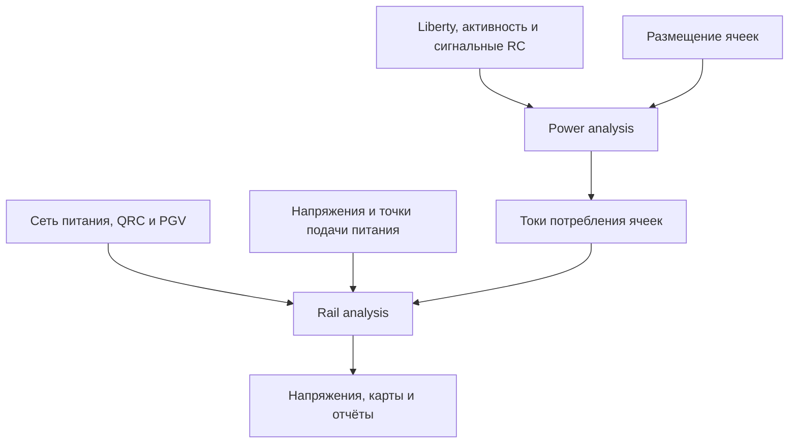

*Рисунок — Основные данные и этапы анализа питания. Схема условная.*

Анализ выполняется для определённого сценария. Его результат относится к выбранным библиотекам, напряжению, температуре, активности и модели источников. Успешное завершение команды и отсутствие заметной просадки на карте ещё не подтверждают корректность исходных условий.

<a id="lab5-basics"></a>

## 2. Основные понятия

### 2.1. Сеть питания

Сеть питания, или **PDN — Power Distribution Network**, соединяет точки подачи питания с выводами ячеек. В учебном блоке этот путь может проходить через кольцо питания, полосы, локальные шины стандартных ячеек и переходные отверстия.

В этой работе рассматривается один постоянно включённый домен с сетями **VDD** и **VSS**, номинальный потенциал VSS равен нулю. Отключаемые домены и power gates в используемые скрипты не включены.

На условной схеме путь к ячейкам проходит через M6, M5, M4 и локальные подключения M1. Через M2/M3 проходят соединения и стеки vias. Такая последовательность иллюстрирует принцип доставки питания на отдельном примере 180 нм. [Схема пути питания](#fig-lab5-pdn).

<a id="fig-lab5-pdn"></a>

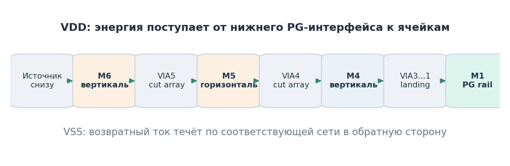

*Рисунок — Путь VDD к ячейке и обратный путь через отдельную сеть VSS. Схема из методики, с. 5; локальные участки M2/M3 не образуют дополнительную распределённую сетку.*

### 2.2. Падение напряжения

Для отдельного резистивного участка:

$$
\Delta V = I R,
$$

где $\Delta V$ — падение напряжения, В; $I$ — ток участка, А; $R$ — его сопротивление, Ом.

Реальная PDN содержит разветвления и параллельные пути. Ток каждого участка зависит от потребления подключённых ячеек и устройства всей сети. Поэтому одну формулу для отдельного сопротивления нельзя без дополнительных предположений применять ко всему блоку.

На стороне VDD локальный потенциал может снижаться, на стороне VSS — повышаться. Напряжение питания конкретной ячейки определяется разностью:

$$
V_{\text{cell}} = VDD_{\text{local}} - VSS_{\text{local}}.
$$

**Условный пример.** При номинальном питании 1,1 В, локальном VDD 1,08 В и локальном VSS 0,01 В ячейка получает 1,07 В. Суммарная потеря составляет 30 мВ.

Снижение напряжения питания обычно увеличивает задержки ячеек и при достаточно большой просадке может нарушить работу схемы. В этой лабораторной изучается питание; влияние на timing не считается автоматически перепроверенным после выполнения rail analysis.

<a id="lab5-extra-resistance"></a>

#### Углублённо. Сопротивление распределённой сети

Сопротивление однородного проводника постоянного сечения можно оценить по его геометрии.

$$
R = \rho \frac{L}{A}.
$$

Здесь $\rho$ — удельное сопротивление в Ом·м, $L$ — длина в метрах, $A$ — площадь поперечного сечения в м². Для прямоугольного сечения $A=wt$, где $w$ — ширина, $t$ — толщина.

При одинаковых длине и толщине более широкая полоса имеет меньшее сопротивление. При экстракции учитываются технологические параметры и фактическая геометрия. Сопротивление массива vias зависит от числа переходов и устройства соединения.

##### Путь и эффективное сопротивление

**Least resistive path** — отдельный путь через сеть с минимальной суммой сопротивлений между рассматриваемой точкой и источником. Он полезен для исследования конкретных участков подключения.

**Effective resistance** учитывает параллельные пути. Его можно определить через отношение напряжения к тестовому току при заданных условиях подключения. Даже два одинаковых параллельных пути дают эквивалентное сопротивление меньше сопротивления любого из них.

В нагруженной PDN напряжение точки зависит также от токов других ячеек. Поэтому произведение тока одной ячейки на её effective resistance в общем случае не равно всей наблюдаемой просадке этой ячейки.

В исходном практикуме есть отдельная операция `report_resistance`. Она не входит в текущий минимальный набор скриптов. Такой анализ может использоваться как дальнейшее расширение после проверки на учебном проекте.

##### Изменение сети питания

Увеличение ширины полос, дополнительные пути и vias, изменение расположения источников могут улучшить доставку тока. Однако добавление металла занимает ресурсы трассировки, а физическое изменение сети требует проверки связности и технологической корректности.

Точки идеальных источников являются частью модели. Их добавление в файл не означает, что в реальной реализации появился новый pad или bump. Такой эксперимент допустим как исследование граничных условий, если это явно указано в выводах.

<a id="lab5-ir-limit"></a>

### 2.3. Допустимое падение напряжения

**Допустимая просадка, или IR-drop budget,** — заданный предел потери напряжения питания относительно принятого опорного значения. Порог позволяет сопоставить результат анализа с требованием к питанию.

Его выбирают по условиям проекта: допустимому диапазону питания ячеек и макросов, условиям проверки timing, запасам на отклонения источника и потерям на пути питания. **Единого допустимого процента для всех технологий и проектов нет.** Напряжение одного доступного файла Liberty само по себе не задаёт весь допустимый бюджет PDN. Если источник в модели подключён непосредственно к точкам кристалла, потери до этих точек учитываются отдельными исходными условиями, а не появляются в расчёте автоматически.

В этой работе для объяснения используем **суммарную потерю локального питания ячейки**, включающую снижение VDD и подъём VSS. При номинальном потенциале VSS, равном нулю:

$$
\Delta V_{\text{cell}} = V_{\text{nom}} - (VDD_{\text{local}} - VSS_{\text{local}}),
$$

$$
\delta_{\text{cell}} = \frac{\Delta V_{\text{cell}}}{V_{\text{nom}}}\cdot100\%.
$$

Здесь $V_{\text{nom}}$ — опорное напряжение питания в данной модели, В; $\Delta V_{\text{cell}}$ — потеря локального питания, В; $\delta_{\text{cell}}$ — относительная просадка, %.

Если предел задан как $\delta_{\text{lim}}$ процентов, условие имеет вид:

$$
\delta_{\text{cell}} \leq \delta_{\text{lim}},
\qquad
V_{\text{cell}} \geq V_{\text{nom}}\left(1-\frac{\delta_{\text{lim}}}{100}\right).
$$

**Для примера 45 нм** возьмём настройки учебного запуска с бюджетом **2%** при $V_{\text{nom}}=1{,}1$ В.

$$
\Delta V_{\text{lim}}=1{,}1\cdot0{,}02=0{,}022\;\text{В}=22\;\text{мВ},
\qquad V_{\text{cell,min}}=1{,}078\;\text{В}.
$$

В учебной модели идеальные источники заданы в нижних точках подачи. Для проектной проверки бюджет блока определяют с учётом требований к питанию ячеек и потерь до этих точек. Применение 2% как обязательного критерия сдачи должно быть явно задано в условии.

Для отдельной сети можно задавать собственный предел: максимальное падение VDD или максимальный подъём VSS. Такой критерий нужно явно отличать от суммарной потери VDD−VSS. Если разрешить весь суммарный бюджет отдельно каждой стороне, допускаемая потеря удвоится.

Для статического анализа оцениваются напряжения при усреднённых токах. Для динамического необходимо дополнительно определить временной интервал и метрику: например, минимум мгновенной разности VDD−VSS либо конкретный показатель effective instance voltage. Эти метрики могут различаться. Их допустимые пределы нельзя молча считать одинаковыми или автоматически складывать максимумы двух отдельных расчётов.

Порог, вид анализа и проверяемую величину зафиксируйте **до сравнения результатов**. Настройка цветовой шкалы GUI не заменяет электрический критерий. Практический порядок проверки приведён в [разделе 6.3](#lab5-ir-limit-check).

### 2.4. Состав потребляемой мощности

В отчёте различаются три составляющие:

| Составляющая | Что описывает |
|---|---|
| **Internal power** | Потребление, связанное с внутренней работой ячейки; определяется библиотечной моделью и условиями переключений |
| **Switching power** | Заряд и разряд внешней нагрузки выходных сигналов |
| **Leakage power** | Потребление, связанное с токами утечки |

Итоговая мощность складывается из этих составляющих. Для грубой оценки среднего тока нагрузки при одном напряжении можно использовать $I_{\text{avg}} \approx P_{\text{avg}}/V$. Это оценка суммарного потребления, а не правило равномерного распределения тока по топологии.

### 2.5. Активность переключений

Потребление зависит от того, какие сигналы переключаются и как часто. В подготовленных скриптах используется оценённая активность, заданная через `set_default_switching_activity` и распространяемая по схеме.

`VOLTUS_INPUT_ACTIVITY` и `VOLTUS_ACTIVITY_PERIOD` задают нормирование входной активности. В рассмотренном интерфейсе плотность переходов соответствует отношению активности к периоду. Проверьте единицы времени Liberty перед тем, как задавать период.

Эта настройка не изменяет clocks из SDC. Тактовые ограничения уже должны присутствовать в восстановленной базе. Reset и другие управляющие входы необходимо задать в состоянии, соответствующем исследуемому режиму.

<a id="lab5-extra-activity"></a>

#### Углублённо. Как активность влияет на мощность

##### Переключательная мощность

В простой модели внешней ёмкостной нагрузки мощность переключения оценивают по формуле.

$$
P_{\text{sw}} \approx \alpha C_L V^2 f.
$$

Здесь $C_L$ — нагрузочная ёмкость в фарадах, $V$ — размах напряжения в вольтах, $f$ — частота нормирования в герцах, $\alpha$ — среднее число переходов $0\rightarrow1$ за период нормирования.

В этой формуле $\alpha$ относится к заряжающим переходам. Перед подстановкой `VOLTUS_INPUT_ACTIVITY` из Makefile проверьте, какие переходы учитывает эта настройка и в каких единицах задан период.

Оценка относится к внешней ёмкостной нагрузке. Internal и leakage power рассчитываются по своим библиотечным моделям и не описываются полностью этой формулой.

##### Почему результат может измениться слабо

Тактовая сеть может продолжать переключаться при слабой активности данных. Некоторые логические узлы сохраняют постоянные значения. Утечки и внутреннее потребление зависят от моделей и состояний. Поэтому изменение одного параметра входной активности не обязательно одинаково масштабирует все составляющие мощности.

При слабом изменении результата сначала установите, действительно ли применены новые настройки, затем исследуйте распределение потребления по группам и иерархии. Не объясняйте отсутствие эффекта особенностями физики, пока не исключена загрузка прежнего результата.

##### Vectorless и VCD

Vectorless использует предположения об активности. Они позволяют выполнить анализ без полного набора событий моделирования, но требуют обоснования выбранного сценария.

VCD задаёт события из конкретного моделирования. Для его использования нужны правильный scope, окно времени, согласованные имена и проверка annotation coverage. Высокое покрытие имён ещё не гарантирует, что выбранное окно отражает все интересующие режимы работы.

VCD уровня RTL может не описывать все внутренние события после синтеза и CTS. Точность и назначение такого расчёта нужно оценивать с учётом реально аннотированных сигналов и дополнительных оценок активности.

### 2.6. Статический и динамический анализ

| Вид анализа сети | Модель потребления | Что исследуем |
|---|---|---|
| **Статический** | Усреднённые токи ячеек | Распределение напряжений при среднем потреблении |
| **Динамический** | Токи, изменяющиеся во времени | Изменения напряжения и просадки при переключениях в исследуемом временном интервале |

**Статический IR drop не означает анализ только утечек.** Средние токи включают потребление от переключений и внутренней работы ячеек.

В **vectorless dynamic** Voltus строит события переключений по активности и таймингам. Полученный сценарий зависит от этих предположений. Вариант с VCD использует события из моделирования и в данную базовую последовательность не входит.

### 2.7. Для чего нужна PGV

**PGV — Power Grid View** представляет ячейку для анализа питания: её подключения к сети, точки приложения токов и доступные электрические свойства. PGV и Liberty выполняют разные задачи.

В первом варианте используется **technology-only** библиотека `techonly.cl`, формируемая по LEF и технологии экстракции QRC. Она общая для статического и динамического скриптов.

В этом варианте не выполняется SPICE-характеризация внутренних ёмкостей стандартных ячеек. Поэтому динамический запуск рассматривается как знакомство с маршрутом расчёта. Исследование влияния decap требует согласованных характеризованных моделей.

<a id="lab5-extra-pgv"></a>

#### Углублённо. Technology-only и характеризованные PGV

Technology-only библиотека использует упрощённое представление питания ячеек по выводам. Нагрузка прикладывается через предусмотренные точки, а ёмкостная модель зависит от доступных исходных данных и настроек. Нулевое значение area-based capacitance не является измеренной нулевой ёмкостью физической ячейки.

Характеризация стандартных ячеек с транзисторными моделями позволяет подготовить дополнительные электрические свойства, включая ёмкости. Для неё нужны согласованные SPICE/Spectre модели, описания ячеек и соответствующие инструменты.

Для макросов может требоваться более подробное описание внутренней сети питания. В исходном практикуме рассматриваются EARLY, IR и EM views и разные режимы точности. Выбор `hd` вместо `xd` сам по себе не создаёт отсутствующую информацию о макросе или ёмкостях.

Для сравнения результатов необходимо фиксировать тип PGV, технологию, состав ячеек и условия характеризации. Совпадение имени `techonly.cl` не означает совпадения содержимого двух библиотек.

<a id="lab5-pdn-calculation"></a>

## 3. Послойный расчёт сети питания блока 45 нм

Питание подаётся снизу на боковые шины M9. Начнём с расчёта потерь на этих шинах. Напряжения на M9 в точках отвода зададут условия питания для полос M8. После M8 перейдём к M7.

<a id="fig-lab5-pdn45-abstract"></a>

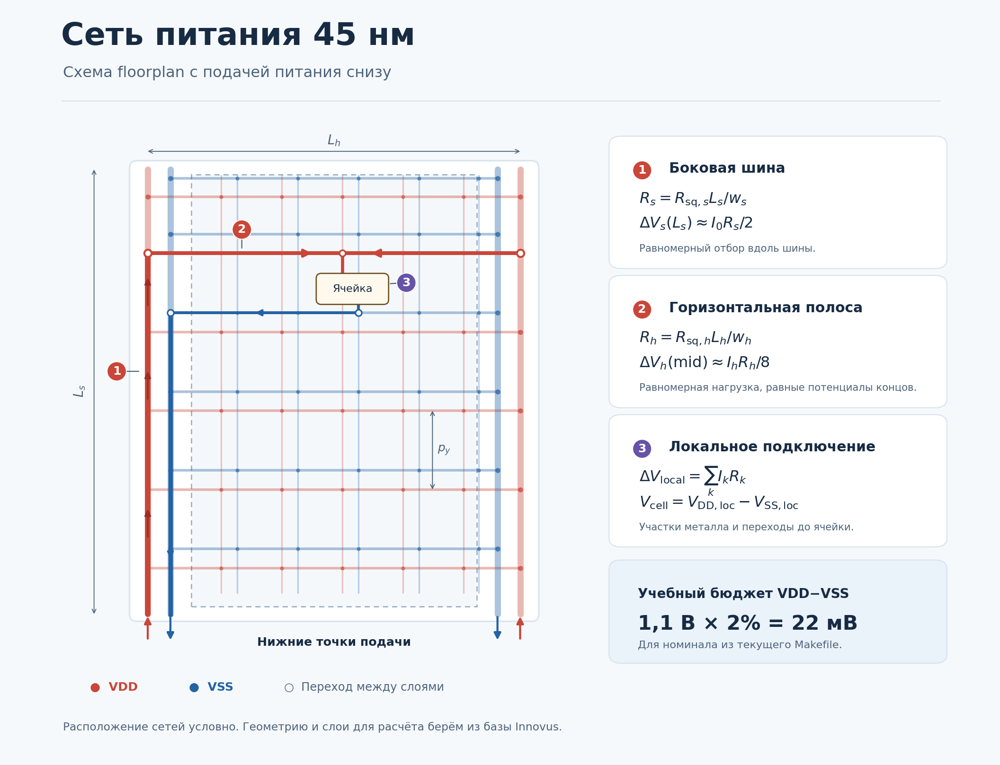

*Рисунок — Расчётная схема по floorplan. Участок ① показывает боковую шину, ② — горизонтальную полосу, ③ — соединение с ячейкой. Разводка VDD/VSS и число полос показаны условно. $L_s$ — длина боковой шины от нижнего ввода, $L_h$ — пролёт горизонтальной полосы, $p_y$ — шаг соседних горизонталей одной сети.*

<a id="lab5-pdn-inputs"></a>

### 3.1. Исходный floorplan и параметры M9

По бокам цифровой области проходят исходные шины M9. Ток VDD идёт от нижних точек подачи вверх к отводам. По шинам VSS ток возвращается к нижним точкам подключения земли.

<a id="fig-lab5-pdn45-topology"></a>

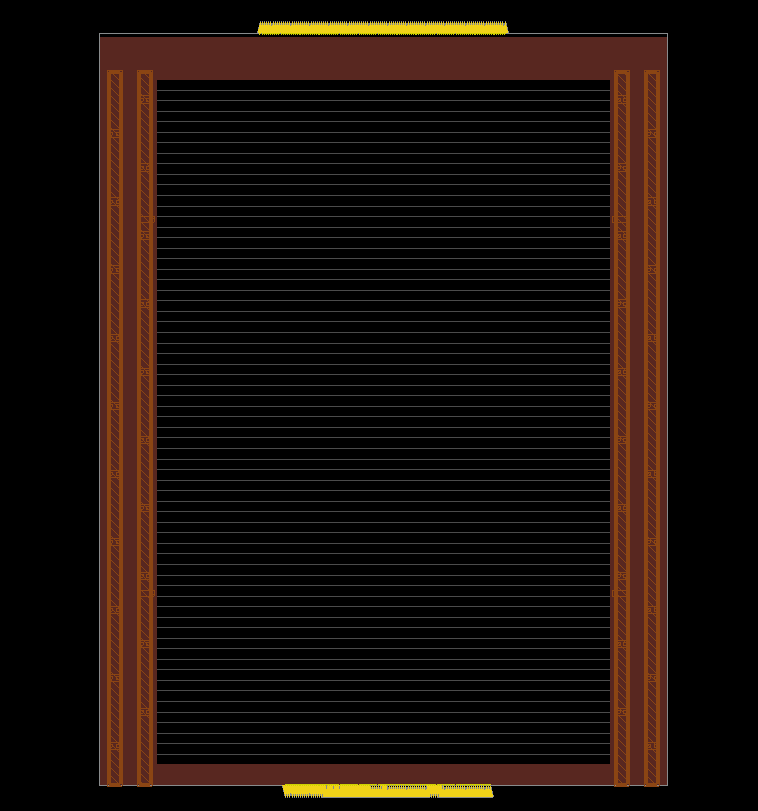

*Рисунок — Исходный floorplan блока 45 нм. Слева и справа расположены по две шины M9.*

| Параметр | Значение |
|---|---|
| Цифровая область (core) | 60 × 91 мкм |
| Кристалл (die) | 75 × 100 мкм |
| Длина одной шины M9 | 95 мкм |
| Ширина одной шины M9 | 2 мкм |
| Номинальные потенциалы источников | VDD = 1,1 В, VSS = 0 В |
| Сопротивление квадрата M9 | 0,030 Ом/□ по FreePDK45 для предварительной оценки |

Для сопротивления шины используем её длину **95 мкм**. Площадь core **5460 мкм²** пригодится позже для оценки нагрузки внутренних полос. Справочное сопротивление квадрата сверяем с tech LEF или моделью экстракции своего PDK. [Таблица металлизации FreePDK45](https://eda.ncsu.edu/freepdk/freepdk45/).

Учебный бюджет на суммарную потерю между VDD и VSS составляет **2%** от номинального питания.

$$
\Delta V_{\mathrm{lim}}=1{,}1\cdot0{,}02=0{,}022\;\text{В}=22\;\text{мВ}.
$$

<a id="lab5-pdn-currents"></a>

### 3.2. Средний ток блока и ток в боковых шинах M9

Из отчёта `static.rpt` берём `Total Power` = **0,62491942**. В примере считаем, что мощность указана в мВт. Единицы сверяем со строкой `Power Units` в заголовке отчёта. При питании 1,1 В средний ток блока равен

$$
I_{\mathrm{block}}\approx\frac{P}{U}
=\frac{0{,}62492\;\text{мВт}}{1{,}1\;\text{В}}
\approx 0{,}5681\;\text{мА}.
$$

При симметричной нагрузке половина тока идёт по каждой из двух шин VDD. Тот же ток возвращается по двум шинам VSS, также поровну. Поэтому ток у нижнего конца каждой боковой шины составляет **0,2841 мА**.

<a id="fig-lab5-m9-current-split"></a>

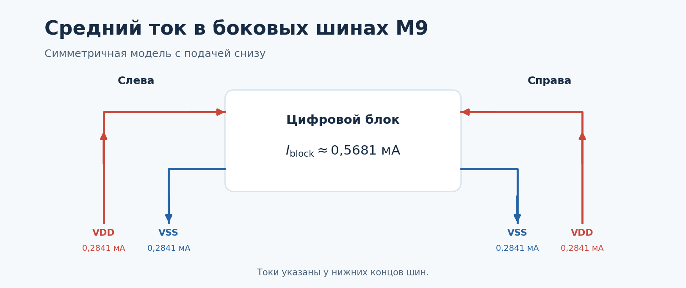

*Рисунок — Подача тока через две шины VDD и возврат через две шины VSS.*

### 3.3. Сопротивление одной боковой шины M9

Сопротивление проводника считаем по формуле $R=\rho L/S$, где $L$ — длина, $\rho$ — удельное сопротивление, а $S=wt$ — площадь сечения. Для металла фиксированной толщины $t$ удобно взять сопротивление квадрата $R_\square=\rho/t$ из данных технологии.

<a id="fig-lab5-m9-sheet-resistance"></a>

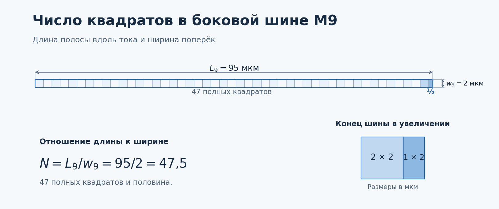

*Рисунок — Условное деление шины M9 на квадраты вдоль тока.*

В шине длиной 95 мкм и шириной 2 мкм помещается 47,5 квадрата. Сопротивление одной шины составляет

$$
R_9=R_\square\frac{L}{w}
=0{,}030\;\text{Ом/□}\cdot47{,}5
=\mathbf{1{,}425\;\text{Ом}}.
$$

### 3.4. Потеря напряжения на M9

Представим, что нагрузка распределена равномерно вдоль шины. Внизу через шину проходит 0,2841 мА, в середине остаётся половина этого тока, а к верхнему концу ток уменьшается до нуля. Для участка шины берём среднее между токами на его концах.

<a id="fig-lab5-m9-drop-profile"></a>

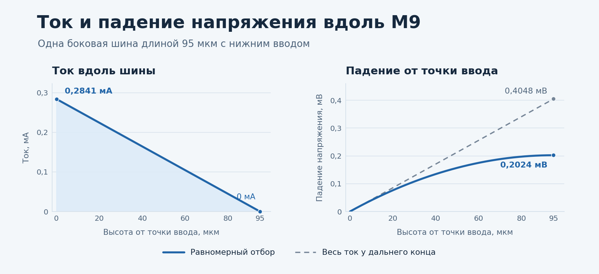

*Рисунок — Сплошная линия показывает равномерную нагрузку вдоль M9. Пунктир на правом графике показывает, каким было бы падение при той же нагрузке, сосредоточенной на верхнем конце.*

Средний ток по всей длине шины равен половине входного. По закону Ома получаем потерю от нижнего ввода до верхнего конца одной шины

$$
\Delta V=I_{\text{ср}}R
\approx\frac{0{,}2841\;\text{мА}}{2}\cdot1{,}425\;\text{Ом}
\approx 0{,}2024\;\text{мВ}.
$$

На верхнем конце VDD падает на 0,2024 мВ, а VSS поднимается на те же 0,2024 мВ. Поэтому разность VDD−VSS уменьшается примерно на **0,4048 мВ**. Пока мы учли только боковые шины M9.

<a id="lab5-pdn-estimate"></a>

### 3.5. Напряжение в точках подключения M8 к M9

Горизонтальная полоса M8 подключается к боковым шинам M9. Возьмём для примера отвод посередине M9, на высоте **47,5 мкм** от нижней точки подачи.

На нижней половине шины сопротивление вдвое меньше полного и равно **0,7125 Ом**. При равномерной нагрузке к середине шины нижние отводы забирают половину тока. На участке ток убывает с 0,2841 мА до примерно 0,142 мА, поэтому средний ток составляет **0,213 мА**. Снова применяем закон Ома.

$$
\Delta V\approx 0{,}213\;\text{мА}\cdot0{,}7125\;\text{Ом}
\approx 0{,}1518\;\text{мВ}.
$$

На эту величину потенциал VDD понижается, а потенциал VSS повышается.

| Величина в точке отвода | Значение |
|---|---:|
| Потенциал VDD на M9 | 1,099848 В |
| Потенциал VSS на M9 | 0,000152 В |
| Разность VDD−VSS | 1,099696 В |
| Потеря питания к этой высоте | **0,3036 мВ** |

<a id="fig-lab5-m9-m8-tap"></a>

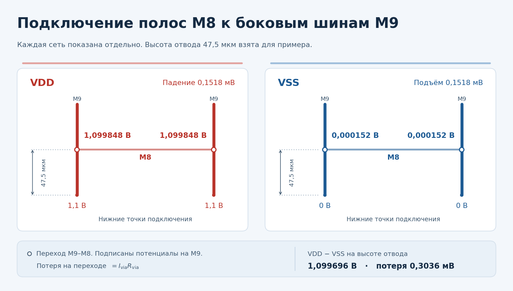

*Рисунок — Подключение M8 к M9 при симметричной нагрузке. VDD и VSS показаны раздельно. Кружки на высоте отвода обозначают переходы M9–M8.*

На рисунке указаны потенциалы на M9 перед переходами. Потерю на каждом переходе считаем отдельно, умножая ток через переход на его сопротивление. При одинаковых потенциалах на M9 и одинаковых потерях на переходах потенциалы концов полосы M8 будут равны.

Для расчёта M8 понадобятся **пролёт между подключениями к M9**, **ширина полосы** и **шаг между соседними полосами одной сети**. Пролёты VDD и VSS измеряем отдельно.

<a id="lab5-pdn-m8"></a>

### 3.6. Падение напряжения вдоль полосы M8

Горизонтальная полоса VDD на M8 подключена к боковым шинам M9 слева и справа. Возьмём для примера **10 полос VDD** с шагом **9,1 мкм** по высоте цифровой области. Пролёт одной полосы между переходами на M9 примем равным **64 мкм**, ширину — **0,8 мкм**. Это учебные размеры. Для своего floorplan берём размеры из Innovus.

<a id="fig-lab5-m8-stripe"></a>

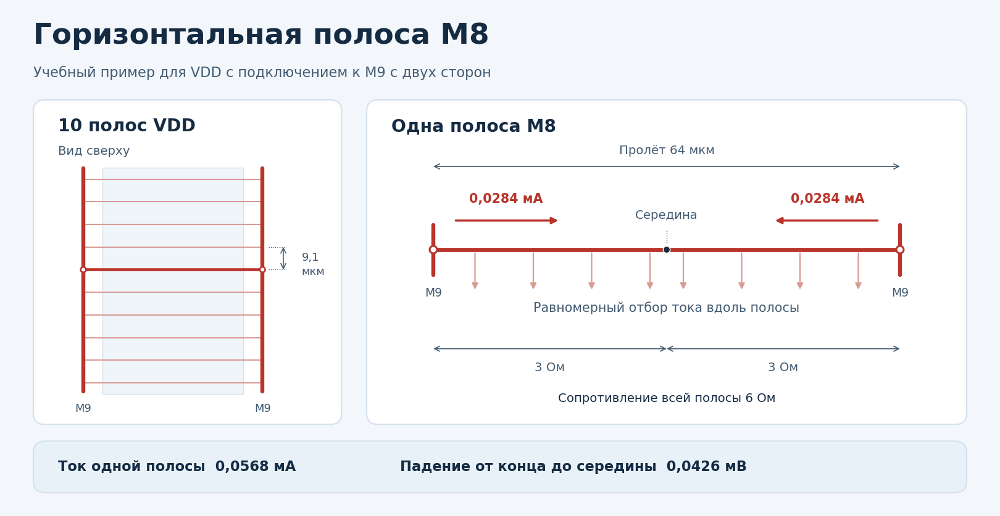

*Рисунок — Полосы VDD на M8 и токи на концах одной полосы. Точки подключения к M9 отмечены кружками.*

**Ток.** При равномерной нагрузке на одну полосу приходится десятая часть тока блока. Делим 0,5681 мА на 10 и получаем **0,0568 мА**. При одинаковых потенциалах на концах и симметричной нагрузке каждый конец отдаёт в полосу половину этого тока, **0,0284 мА**.

**Сопротивление.** Для M8 по FreePDK45 берём 0,075 Ом/□. По формуле из §3.3 получаем $R_8=0{,}075\cdot64/0{,}8=6$ Ом. От конца полосы до середины сопротивление вдвое меньше, **3 Ом**. [Таблица металлизации FreePDK45](https://eda.ncsu.edu/freepdk/freepdk45/).

**Падение напряжения.** Каждая сторона питает свою половину полосы. При равномерном отборе вдоль полосы ток в половине убывает от 0,0284 мА у конца до нуля в середине. Средний ток на этом участке — **0,0142 мА**. Умножаем его на сопротивление участка.

$$
\Delta V_8\approx 0{,}0142\;\text{мА}\cdot3\;\text{Ом}
=\mathbf{0{,}0426\;\text{мВ}}.
$$

На середине полосы VDD ниже, чем на её концах, на **0,0426 мВ**. Чтобы получить потерю от нижнего ввода до этой точки, к вкладу M8 добавляем потерю на M9 до отвода и падение на переходе M9–M8. Через каждый переход в этом примере проходит 0,0284 мА.

При той же нагрузке меньший шаг уменьшает ток на одну полосу, а большая ширина уменьшает её сопротивление. Для VSS применяем тот же расчёт с размерами её полос.

<a id="lab5-pdn-m7"></a>

### 3.7. Падение напряжения на участке M7

Вертикальные полосы VDD на M7 соединяются с горизонтальными полосами VDD на M8 через переходы. Рассмотрим один внутренний участок M7 между соседними полосами M8. Его длина равна шагу M8, **9,1 мкм**. Для учебного примера примем **ширину M7 0,8 мкм** и **шаг M7 6 мкм** между полосами VDD.

<a id="fig-lab5-m7-segment"></a>

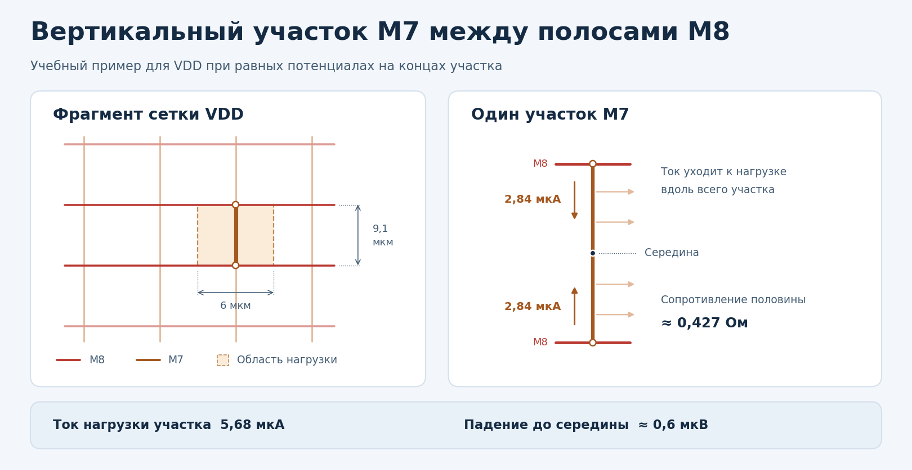

*Рисунок — Нагрузка участка M7 и подача тока с двух концов при равных потенциалах. Кружками показаны переходы M8–M7 на концах выбранного участка.*

**Ток.** При равномерной нагрузке участок обслуживает прямоугольник **6 × 9,1 мкм**. Это 1% площади цифровой области 60 × 91 мкм. Значит, на участок приходится 1% тока блока, или **5,68 мкА**.

**Сопротивление.** Для M7 по FreePDK45 берём 0,075 Ом/□. Весь участок имеет сопротивление $0{,}075\cdot9{,}1/0{,}8\approx0{,}853$ Ом. От конца до середины получаем **0,427 Ом**. [Таблица металлизации FreePDK45](https://eda.ncsu.edu/freepdk/freepdk45/).

**Падение напряжения.** Для ручной оценки примем одинаковые потенциалы на обоих концах и равномерный отбор тока вдоль участка. Тогда каждый конец подаёт **2,84 мкА**. Ток убывает до нуля в середине, поэтому средний ток вдоль половины участка равен **1,42 мкА**.

$$
\Delta V_7 \approx 1{,}42\;\text{мкА}\cdot 0{,}427\;\text{Ом}
\approx \mathbf{0{,}6\;\text{мкВ}}.
$$

Это локальное падение в металле M7 от конца до середины участка. В реальной сетке соседние M8 подключены к M9 на разных высотах, поэтому потенциалы на концах M7 могут отличаться и ток будет делиться иначе. Voltus учитывает такое перераспределение и сопротивления переходов при расчёте всей сетки.

<a id="lab5-pdn-vias"></a>

### 3.8. Падение напряжения на переходах между слоями

Чтобы посчитать падение на переходе, умножаем **ток через весь переход** на его сопротивление. Находим этот ток по тому, какие участки питаются через данную точку.

- **M9 → M8.** Через переход у одного конца полосы M8 в примере из §3.6 проходит **28,4 мкА**. Второй конец полосы получает свою долю тока через отдельный переход.
- **M8 → M7.** Во внутреннем пересечении ток после перехода расходится по M7 в обе стороны. В симметричном примере из §3.7 в каждый соседний участок идёт **2,84 мкА**. Значит, через переход проходит **5,68 мкА**.

<a id="fig-lab5-pg-vias"></a>

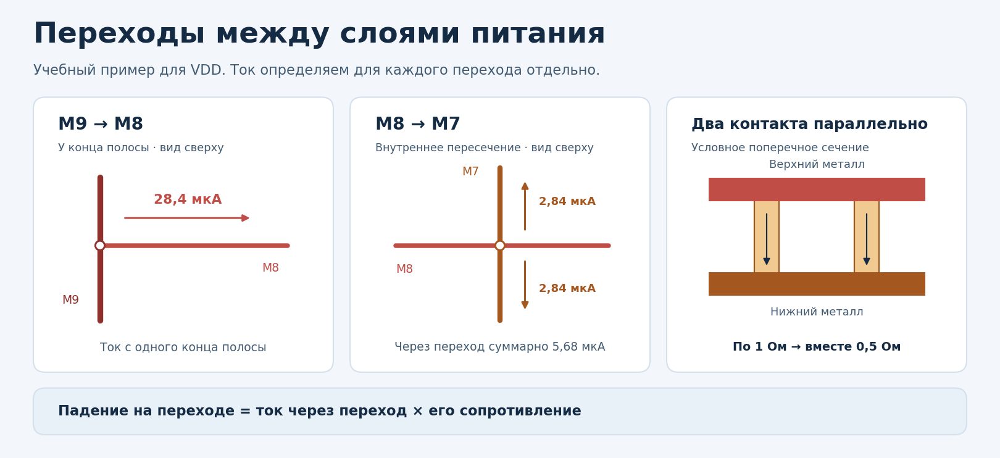

*Рисунок — Кружками на видах сверху обозначены переходы между слоями. Справа показано, как два контакта соединяют одни и те же слои.*

Для учебной оценки примем сопротивление одного контакта (**via cut**) равным **1 Ом**. Два одинаковых контакта между теми же слоями соединены параллельно. Их общее сопротивление в этой модели равно **0,5 Ом**.

| Переход | Ток через переход | Падение при одном контакте | Падение при двух контактах |
|---|---:|---:|---:|
| M9 → M8 у одного конца полосы | 28,4 мкА | 28,4 мкВ | 14,2 мкВ |
| M8 → M7 во внутреннем пересечении | 5,68 мкА | 5,68 мкВ | 2,84 мкВ |

Для сравнения в таблице ток через переход оставляем тем же. В реальной разводке число контактов зависит от размера площадки и правил технологии, а сопротивление перехода берём из модели экстракции.

<a id="lab5-pdn-summary"></a>

### 3.9. От ручной оценки к проверке в Voltus

Оценим VDD в середине участка M7 между двумя соседними полосами M8. Сначала найдём характерный потенциал в середине M8. Возьмём высоту отвода **47,5 мкм** из §3.5, симметричную подачу с двух сторон и один контакт сопротивлением **1 Ом** на каждом переходе. По одному подводу до середины M8 получаем **0,2228 мВ** падения, или **1,0997772 В** при напряжении ввода 1,1 В.

Для ручной оценки примем, что оба пересечения M8 с выбранной полосой M7 имеют этот потенциал. Это приближение для двух соседних подводов. В реальной сетке их потенциалы зависят от положения и нагрузки.

<a id="fig-lab5-pdn-summary"></a>

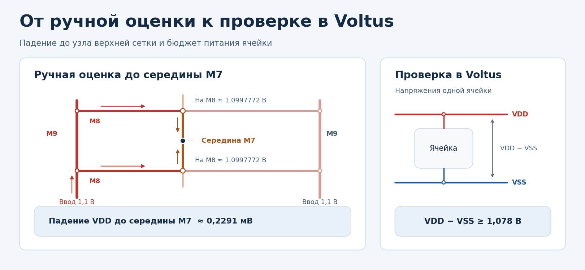

*Рисунок — Слева путь от нижних вводов до середины M7, справа критерий для питания ячейки в Voltus.*

| Участок выбранного подвода | Падение VDD |
|---|---:|
| По M9 от нижнего ввода до отвода на M8, §3.5 | 0,1518 мВ |
| На одном переходе M9–M8, §3.8 | 0,0284 мВ |
| По M8 от конца полосы до середины, §3.6 | 0,0426 мВ |
| **От ввода до середины M8** | **0,2228 мВ** |
| На одном переходе M8–M7, §3.8 | 0,00568 мВ |
| По M7 от конца участка до середины, §3.7 | 0,0006 мВ |
| **От ввода до середины M7** | **≈ 0,2291 мВ** |

На каждом переходе M8–M7 теряем **5,68 мкВ**. Поэтому напряжение на обоих концах участка M7 составляет примерно **1,0997715 В**. От любого конца до середины теряем ещё **0,6 мкВ** и получаем **около 1,0997709 В**. Падения по двум подводам равны, поскольку оба ведут от одинакового напряжения ввода к одной точке M7.

**Проверка в Voltus.** Ручная оценка доведена до точки M7. В Voltus учитываем всю сеть до выводов ячеек. Для каждой ячейки берём её локальные VDD и VSS и вычисляем разность. При номинале **1,1 В** и бюджете потерь **22 мВ** минимальное значение VDD−VSS по ячейкам должно быть **не ниже 1,078 В**.

<a id="lab5-pdn-sizing"></a>

### 3.10. Как подобрать ширину и шаг полос

Возьмём исходную сетку M8 из §3.6. Сравним два изменения по отдельности. Сохраним ток блока, пролёт полос **64 мкм** и те же допущения о равномерной нагрузке и подаче питания с двух сторон. Шаг измеряем между соседними полосами **VDD**.

<a id="fig-lab5-m8-sizing"></a>

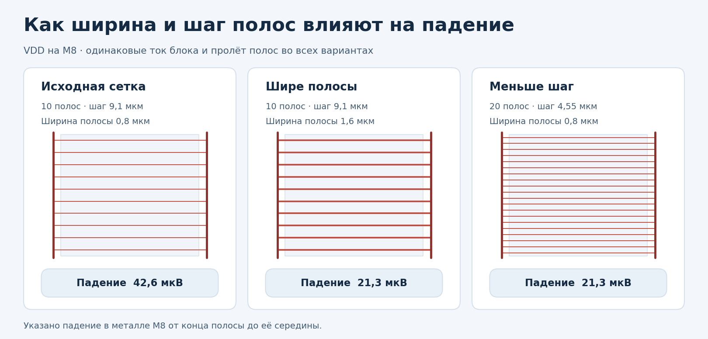

*Рисунок — Сравнение падения в металле M8 от конца полосы до её середины.*

| Параметр | Исходная сетка | Полосы вдвое шире | Шаг вдвое меньше |
|---|---:|---:|---:|
| Число полос VDD | 10 | 10 | 20 |
| Ширина полосы | 0,8 мкм | 1,6 мкм | 0,8 мкм |
| Шаг полос VDD | 9,1 мкм | 9,1 мкм | 4,55 мкм |
| Ток одной полосы | 56,8 мкА | 56,8 мкА | 28,4 мкА |
| Сопротивление всей полосы | 6 Ом | 3 Ом | 6 Ом |
| **Падение от конца до середины M8** | **42,6 мкВ** | **21,3 мкВ** | **21,3 мкВ** |

У широкой полосы вдвое меньше сопротивление. При меньшем шаге нагрузка делится между вдвое большим числом полос, поэтому ток каждой полосы вдвое меньше. В обоих случаях падение в металле M8 уменьшается вдвое.

Оба варианта занимают вдвое больше площади металла VDD на M8. Меньший шаг M8 также сокращает участки M7 между соседними подключениями. При выборе варианта учитываем место для полос VSS, переходов и сигнальной трассировки. После построения сетки проверяем правила технологии и оцениваем в Voltus питание ячеек по критерию из §3.9.

<a id="lab5-pdn-final-view"></a>

### 3.11. Как выглядит сеть питания после расчёта

Покажем базовый вариант сетки из §3.1, §3.6 и §3.7. Питание подаётся снизу на боковые шины M9. От них горизонтальные полосы M8 распределяют ток поперёк блока, а вертикальные полосы M7 разносят питание вдоль него.

<a id="fig-lab5-pdn45-final"></a>


*Рисунок — Базовая сетка M9–M8–M7. Красным показана VDD, синим — VSS. Кружками обозначены переходы между проводниками одной сети.*

#### Параметры для повторения в Innovus

Размер кристалла (die) **75 × 100 мкм**, цифровой области (core) **60 × 91 мкм**. Начните с количества и ширины полос на каждом слое.

| Слой | Направление | VDD | VSS | Ширина одной полосы |
|---|---|---:|---:|---:|
| **M9** | Вертикальные боковые шины | 2 | 2 | 2 мкм |
| **M8** | Горизонтальные полосы | 10 | 10 | 0,8 мкм |
| **M7** | Вертикальные полосы | 10 | 10 | 0,8 мкм |

1. **M9.** Разместите слева и справа по одной шине VDD и VSS длиной **95 мкм**. На рисунке VSS ближе к краю кристалла, VDD — к core.
2. **M8.** Разместите **10 пар VDD/VSS** равномерно по высоте core. Шаг между соседними парами **9,1 мкм**. Полосы VDD и VSS чередуются с интервалом в половину этого шага. Доведите каждый конец полосы до боковой шины M9 своей сети с перекрытием для перехода.
3. **M7.** Разместите **10 пар VDD/VSS** равномерно по ширине core с шагом **6 мкм** между парами. Полосы VDD и VSS чередуются с интервалом в половину шага и проходят на всю высоту core.

Поставьте переходы в местах пересечения металла одной сети. Для M9–M8 получится **20 мест на сеть**, для M8–M7 — **100 мест на сеть**. Подберите типы переходов и число cuts по PDK, затем проверьте DRC и связность VDD и VSS.

Для анализа в Voltus расположите по одной точке подачи внутри нижнего конца каждой шины M9. Возьмите их координаты из построенного floorplan и запишите в файлы по формату §4.6.

Для скриншота откройте вид сверху и впишите весь die в окно. Оставьте видимыми контуры die и core, M7, M8, M9 и переходы между ними. Выделите VDD и VSS разными цветами. На общем виде покажите четыре боковые шины и всю сетку, а на увеличенном фрагменте — переход одной сети и соседнее пересечение VDD с VSS.

<a id="lab5-preparation"></a>

## 4. Подготовка и запуск

<a id="lab5-project-choice"></a>

### 4.1. Выбор проекта

Можно выбрать один из двух вариантов:

1. **Собственный проект.** Используйте проект из лабораторной работы 4 или другой синтезируемый цифровой блок. Самостоятельно подготавливать новую архитектуру специально для этой работы не обязательно.
2. **Готовый учебный вариант.** Используйте простой дизайн и полностью подготовленный floorplan, предоставленные преподавателем. Для базового задания на «4» разрабатывать RTL и самостоятельно строить floorplan не требуется: нужно пройти предоставленный маршрут, проверить результат и выполнить анализ в Voltus.

Для обоих вариантов действуют одинаковые задания и критерии оценки. Оцениваются настройка анализа, проверки, чтение результатов и объяснение эксперимента; самостоятельная разработка RTL не является обязательным условием получения оценки.

При выборе собственного проекта обеспечьте его совместимость с учебным маршрутом, библиотеками и используемым floorplan. Самостоятельное построение floorplan по рисунку относится к дополнительному заданию на «5», в том числе при использовании готового RTL.

К началу анализа в Voltus выбранный проект должен удовлетворять следующим условиям:

- Содержать последовательностную и комбинационную логику с осмысленным режимом работы и переключениями.
- Иметь корректные тактовые ограничения и определённые состояния управляющих сигналов.
- Быть подготовленным до физической реализации после routing с подключённым питанием.
- Использовать ячейки и макросы, для которых доступны необходимые логические, физические и электрические модели.
- Иметь согласованные входные данные из следующего раздела; не содержать неподдержанных black box, мешающих анализу.

Для готового варианта преподаватель предоставляет исходный RTL или ссылку на зафиксированную версию, ограничения, полностью готовый floorplan и настройки маршрута. Для задания на «5» используется рисунок инициализированного floorplan, по которому студент создаёт свою реализацию. Раздел 3 разбирает сетку 45 нм с вводом питания снизу. Для запуска любого учебного варианта требуются его RTL или netlist, физические данные и модели. Эти материалы преподаватель предоставляет вместе с условиями варианта.

| Оценка | Что предоставляется | Что делает студент |
|---|---|---|
| «4» | Простой дизайн, полностью готовый floorplan и управляющие файлы маршрута | Проходит маршрут, выполняет проверки и анализ питания, показывает и объясняет результат |
| «5» | Те же исходные RTL и модели, а также рисунок floorplan с исходными боковыми шинами | Самостоятельно строит floorplan по рисунку, создаёт два варианта PDN и сравнивает результаты |

<a id="lab5-voltus-inputs"></a>

### 4.2. Необходимые данные

Сохраните **физическую базу после routing** и **сигнальный SPEF** из одного прогона Innovus. По базе Voltus восстанавливает размещение и геометрию сети питания. Сигнальный SPEF содержит паразитные параметры межсоединений для расчёта мощности.

<a id="fig-lab5-voltus-inputs"></a>

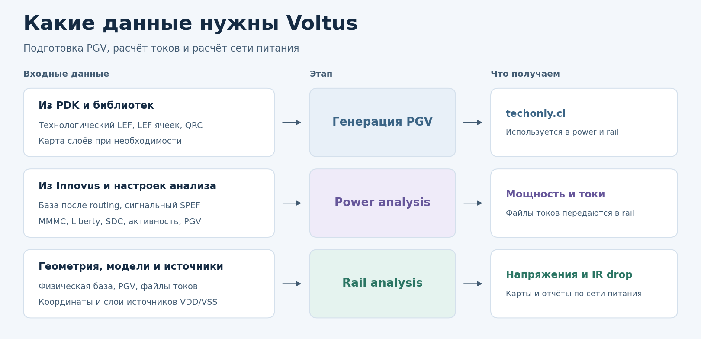

*Рисунок — Подготовка PGV, получение токов на этапе power analysis и расчёт напряжений на этапе rail analysis.*

| Откуда берём | Что понадобится | Что проверить |
|---|---|---|
| Из Innovus | База после routing и один сигнальный SPEF | Файлы относятся к одному проекту и одной версии разводки. SPEF соответствует выбранному RC corner |
| Из PDK и библиотек | Технологический LEF, LEF ячеек, технология экстракции QRC и карта слоёв, если она нужна | При генерации PGV технологический LEF стоит первым. При восстановлении базы доступны её MMMC, Liberty и SDC |
| Из настроек проекта | Analysis view, RC corner, напряжение, температура, активность и два файла точек подачи VDD/VSS | Имена view и corner взяты из MMMC. Точки подачи попадают на проводники нужной сети и слоя, см. §4.6 |

Сначала выполните `make voltus.pgv`, чтобы получить **`techonly.cl`**. Эту библиотеку используют оба этапа в `voltus.static` и `voltus.dynamic`. **Power analysis** рассчитывает мощность и записывает токи. **Rail analysis** читает полученные токи, учитывает точки подачи и рассчитывает напряжения в физической сети питания.

<a id="lab5-voltus-control"></a>

### 4.3. Управляющие файлы

Из корня проекта запускаем нужную цель Makefile. Она подготавливает рабочий каталог, передаёт настройки в окружение и запускает Voltus. В шаблоне используется `voltus -stylus`. Параметр `-init` задаёт Tcl-скрипт, а `-log` задаёт путь к логу.

| Команда | Скрипт в `flow_scripts/` | Что выполняет |
|---|---|---|
| `make voltus.pgv` | `flow.voltus.pgv.tcl` | Создаёт и проверяет библиотеку `techonly.cl` |
| `make voltus.static` | `flow.voltus.static.tcl` | Рассчитывает среднюю мощность и статический IR drop |
| `make voltus.dynamic` | `flow.voltus.dynamic.tcl` | Запускает динамический power и rail analysis с активностью из настроек |
| `make voltus.gui` | `flow.voltus.gui.tcl` | Открывает физическую базу и сохранённые результаты расчёта |

<a id="fig-lab5-make-tcl"></a>

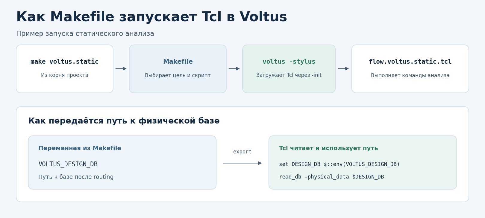

*Рисунок — Как Makefile выбирает скрипт и передаёт ему путь к базе Innovus.*

Например, в блоке **Voltus settings** Makefile переменная `VOLTUS_DESIGN_DB` задаёт путь к базе после routing. Makefile экспортирует её, а `flow.voltus.static.tcl` считывает значение из окружения и использует при загрузке базы.

```tcl
set DESIGN_DB $::env(VOLTUS_DESIGN_DB)
read_db -physical_data $DESIGN_DB
```

Перед первым расчётом запустите `make voltus.pgv`. Цели `voltus.static` и `voltus.dynamic` проверяют наличие готовой библиотеки по пути `VOLTUS_PGV_LIBRARY`. Команда `make -n voltus.static` позволяет посмотреть, какой скрипт и рабочий каталог выберет Makefile для статического расчёта.

### 4.4. Рабочий каталог и относительные пути

Все команды `make` выполняются **из корня проекта**. По умолчанию этапы работают в отдельных каталогах.

| Цель Makefile | Рабочий каталог | Результаты |
|---|---|---|
| `voltus.pgv` | `run/voltus.pgv` | `out/pgv/tech_pgv`, `reports/`, `logs/voltus_pgv.log` |
| `voltus.static` | `run/voltus.static` | `out/static_power`, `reports/static_rail`, `logs/voltus_static.log` |
| `voltus.dynamic` | `run/voltus.dynamic` | `out/dynamic_power`, `reports/dynamic_rail`, `logs/voltus_dynamic.log` |
| `voltus.gui` | `run/voltus` | `logs/voltus_gui.log` |

В таблице показана рабочая конфигурация `s13207` с каталогом `out`. В шаблоне Makefile он называется `outputs`. Фактическое имя задаётся переменными `VOLTUS_PGV_OUTPUT_DIR`, `VOLTUS_STATIC_OUTPUT_DIR` и `VOLTUS_DYNAMIC_OUTPUT_DIR`. В выбранный выходной каталог записываются PGV или файлы power analysis. В `reports` находятся отчёты проверки PGV или результаты rail analysis, в `logs` — логи инструмента.

Выполните `make voltus.pgv` перед статическим или динамическим расчётом. Оба расчёта используют одну библиотеку по пути `VOLTUS_PGV_LIBRARY`. В конфигурации из таблицы это `run/voltus.pgv/out/pgv/tech_pgv/techonly.cl`. Makefile формирует абсолютные пути к входным файлам и результатам. При переопределении путей сохраняйте этот формат.

### 4.5. Настройки Voltus в Makefile

| Переменные | Что указать |
|---|---|
| `VOLTUS_LEF_FILES`, `VOLTUS_QRC_TECH_FILE`, `VOLTUS_LEF_LAYER_MAP` | LEF через пробел с технологическим LEF на первом месте, файл QRC и карта слоёв при необходимости |
| `VOLTUS_POWER_PIN`, `VOLTUS_GROUND_PIN` | Имена выводов питания библиотечных ячеек для генерации PGV |
| `VOLTUS_FILLER_CELLS`, `VOLTUS_DECAP_CELLS` | Имена ячеек через пробел. Оставьте список пустым, если этот тип ячеек отсутствует |
| `VOLTUS_DESIGN_DB`, `VOLTUS_SPEF_FILE` | Пути к физической базе и SPEF после routing. Сверьте их с фактическими выходами `innovus.impl` |
| `VOLTUS_ANALYSIS_VIEW`, `VOLTUS_RC_CORNER` | Имена view и RC corner из `ENV_MMMC`. Заполните оба поля перед static/dynamic |
| `VOLTUS_VOLTAGE`, `VOLTUS_TEMPERATURE` | Напряжение в вольтах и температура в °C для выбранных условий |
| `VOLTUS_IR_DROP_FRACTION` | Порог просадки для `CORE` в долях номинального напряжения. Учебное значение `0.02` соответствует 2% |
| `VOLTUS_POWER_NET`, `VOLTUS_GROUND_NET` | Имена сетей питания проекта, по умолчанию из `ENV_POWER_NETS` и `ENV_GROUND_NETS` |
| `VOLTUS_VDD_PAD_FILE`, `VOLTUS_VSS_PAD_FILE` | Пути к файлам точек подачи питания |
| `VOLTUS_INPUT_ACTIVITY`, `VOLTUS_ACTIVITY_PERIOD`, `VOLTUS_CLOCK_GATE_RATIO` | Входная активность, нормирующий период в единицах Liberty и доля активности на выходе clock gates |
| `VOLTUS_TIME_RESOLUTION` | Временное разрешение динамического расчёта |
| `VOLTUS_GUI_POWER_DB`, `VOLTUS_GUI_RAIL_STATE`, `VOLTUS_GUI_PLOT` | Power DB, каталог состояния выбранного запуска и начальная карта |

#### Пример настроек для s13207 и NanGate45

В рабочем варианте `typ` используется и как analysis view, и как RC corner. Проверьте оба имени по MMMC. Для другого проекта возьмите имена из его конфигурации.

```makefile
export VOLTUS_ANALYSIS_VIEW     = typ
export VOLTUS_RC_CORNER         = typ
export VOLTUS_VOLTAGE           = 1.1
export VOLTUS_IR_DROP_FRACTION  = 0.02

export VOLTUS_DESIGN_DB         = $(ENV_DB)
export VOLTUS_SPEF_FILE         = $(INNOVUS_IMPL_OUTPUT_DIR)/$(ENV_DESIGN).$(VOLTUS_RC_CORNER).spef.gz
```

`VOLTUS_DESIGN_DB` должен указывать на фактически сохранённую базу после routing. При `INNOVUS_IMPL_OUTPUT_DIR = $(INNOVUS_IMPL_RUN_DIR)/out` переменная `VOLTUS_SPEF_FILE` указывает на `run/innovus_impl/out/s13207.typ.spef.gz`. Оставьте в ней один путь к файлу.

Для разового запуска можно переопределить настройку в командной строке.

```bash
make voltus.static VOLTUS_INPUT_ACTIVITY=0.1
```

Условия анализа и критерий просадки запишите вместе с результатами. При необходимости задайте рабочие состояния управляющих сигналов через `set_switching_activity` в Tcl.

### 4.6. Точки подачи питания

Для VDD и VSS подготовьте отдельные файлы формата `xy`. Каждая строка задаёт имя источника, координаты и слой:

```text
*vsrc_name x y layer_name
vsrc1 22.215 374.800 Metal5
```

Это **пример формата**, а не координаты для вашего блока. Координаты задаются в микрометрах. Источник должен попадать на проводник нужной сети и указанного слоя. Число и расположение источников задают принятую модель питания; их необходимо сохранить вместе с результатами.

До начала расчёта убедитесь, что:

- [ ] Восстанавливается нужная база после routing, доступны её библиотеки и ограничения.
- [ ] Имена VDD/VSS и подключения питания соответствуют проекту.
- [ ] Для всех используемых ячеек доступны необходимые библиотечные представления.
- [ ] Технология QRC и карта слоёв относятся к выбранному PDK.
- [ ] Напряжение, температура, analysis view и RC corner согласованы.
- [ ] Известны единицы времени, мощности и напряжения.
- [ ] Активность соответствует исследуемому режиму; reset не удерживает схему в состоянии сброса вместо рабочего режима.
- [ ] Пути в блоке **Voltus settings** указывают на фактические входные файлы и каталоги результатов.

<a id="lab5-practice"></a>

## 5. Практические этапы

Команды в блоках `bash` выполняются в терминале Linux, команды в блоках `tcl` — в консоли Voltus. Запускайте этапы последовательно в отдельных сеансах. После проверки результата завершайте предыдущий сеанс командой `exit`.

Содержимое расчётных Tcl ниже объясняется по назначению команд. **После запуска скрипта через Makefile повторно выполнять его расчётные команды не требуется.**

<a id="lab5-physical-flow"></a>

### 5.1. Прохождение физического маршрута

**Задача этапа:** получить физическую базу и паразитные параметры для анализа питания. Для задания на «4» используется полностью готовый floorplan преподавателя; самостоятельное его построение выполняется в задании на «5».

1. Выберите учебный дизайн и настройте входные файлы предоставленного маршрута. В базовом варианте сохраните выданные параметры floorplan и питания.
2. Если исходными данными служит RTL, выполните синтез через существующую цель:

   ```bash
   make genus.syn
   ```

3. Запустите этап floorplan, используя предоставленный готовый вариант:

   ```bash
   make innovus.fp
   ```

4. Пройдите placement, CTS и routing через подготовленный implementation-скрипт:

   ```bash
   make innovus.impl
   ```

5. Выполните предусмотренные маршрутом проверки, просмотрите логи и физическую реализацию. Сохраните базу после routing и соответствующий SPEF, запишите их фактические пути и условия.
6. Укажите полученные файлы в блоке **Voltus settings** и переходите к подготовке PGV и анализу питания.

Цели Makefile запускают предоставленные Tcl-файлы; конкретные операции определяются их содержимым. В выпускаемой версии учебного flow этап `innovus.fp` должен использовать выданный готовый floorplan, а implementation-скрипт — завершать необходимые физические операции и сохранение данных. Подключение этого варианта и выходные пути необходимо проверить до выдачи задания.

<a id="lab5-pgv"></a>

### 5.2. Генерация PGV

**Задача этапа:** подготовить представления библиотечных ячеек для анализа сети питания.

1. Укажите в Makefile технологические файлы и параметры PGV.
2. Из корня проекта выполните:

   ```bash
   make voltus.pgv
   ```

3. Просмотрите сообщения генерации и результаты `check_pg_library`.
4. Проверьте состав ячеек и наличие необходимых представлений. Разберите сообщения о неизвестных слоях, отсутствующих выводах и неполном покрытии.
5. Сохраните управляющий скрипт, сведения о моделях и отчёты проверки.

В скрипте `read_physical` читает LEF, `set_pg_library_mode` задаёт тип и параметры библиотеки, `write_pg_library` выполняет генерацию, а `check_pg_library` проверяет полученный результат.

Результат находится в `run/voltus.pgv/out/pgv/tech_pgv/techonly.cl`. Отчёты проверки находятся в `run/voltus.pgv/reports`, лог — в `run/voltus.pgv/logs/voltus_pgv.log`. Сохраняйте объект `.cl` целиком, включая его содержимое, если Voltus создал каталог.

Переходите к анализу после проверки библиотеки. Повторная генерация не нужна только из-за изменения входной активности; изменение технологии, состава ячеек или условий библиотечной модели требует проверки её применимости.

<a id="lab5-static"></a>

### 5.3. Статический анализ

**Задача этапа:** определить среднее потребление схемы, получить токи VDD/VSS и рассчитать распределение напряжений в сети питания.

1. Задайте в Makefile базу, view, SPEF, условия, активность и источники.
2. Из корня проекта выполните:

   ```bash
   make voltus.static
   ```

3. Просмотрите лог: восстановленный проект, выбранные условия, сообщения библиотек и активности, результаты power и rail analysis.
4. Откройте `run/voltus.static/out/static_power/static.rpt`. Проверьте единицы, составляющие мощности, представленные группы ячеек и правдоподобность результата.
5. Убедитесь, что созданы токи для обеих сетей, power DB и каталог состояния rail analysis.
6. Запишите фактический путь к каталогу состояния — он понадобится для GUI.

Основные команды связаны следующим образом:

| Команда | Что проверить | Для чего |
|---|---|---|
| `read_db`, `read_spef` | Проект, доступность библиотек, выбранный RC corner | Анализировать нужную физическую реализацию |
| `set_db power_view` | Существующий analysis view | Выбрать условия power analysis |
| `set_default_switching_activity`, `propagate_activity` | Источник и распространение активности | Получить осмысленные токи потребления |
| `report_power` | Сводку мощности и файлы токов | Подготовить нагрузку сети питания |
| `set_rail_analysis_config` | Метод `static`, модели, температуру | Настроить расчёт PDN |
| `set_rail_analysis_domain` | Сети VDD/VSS и `-threshold` | Задать домен `CORE` и порог проверки просадки |
| `set_power_pads` | Сети, координаты и слои источников | Задать граничные условия питания |
| `set_power_data` | Файлы `static_<net>.ptiavg` для VDD и VSS | Передать усреднённые токи в rail analysis |
| `report_rail` | Домен `CORE`, завершение и выходной каталог | Получить напряжения и отчёты |

`CORE` — имя домена анализа, создаваемого в учебном скрипте. Это не имя встроенной функции и не обязательное имя домена любого проекта.

| Выходные данные | Содержимое |
|---|---|
| `out/static_power/static.rpt` | Отчёт средней мощности |
| `out/static_power/static_power.db` | Power DB для просмотра распределения потребления |
| `out/static_power/static_VDD.ptiavg`, `static_VSS.ptiavg` | Средние токи по сетям при именах VDD/VSS |
| `reports/static_rail/` | Каталог с состояниями и отчётами rail analysis |
| `logs/voltus_static.log` | Условия запуска, сообщения и диагностика |

В таблице пути указаны **от `run/voltus.static`**. Имена файлов токов зависят от имён сетей.

Почти нулевое потребление или малая просадка требуют объяснения. Сначала проверьте clocks, активность, reset и библиотечные данные, затем оценивайте качество сети.

<a id="lab5-debug-threshold"></a>

#### Отладка VOLTUS-1246

Сообщение о пороге означает, что для `CORE` нужно задать порог домена либо пороги сетей. Для следующих запусков проверьте `VOLTUS_IR_DROP_FRACTION` в Makefile и его передачу в `set_rail_analysis_domain` в Tcl. Пример ниже использует учебные 2%, или 22 мВ при 1,1 В.

Если в открытой сессии команда `set_power_data` уже загрузила токи для текущей реализации, задайте порог и повторите rail analysis.

```tcl
set_rail_analysis_domain -domain_name CORE \
    -power_nets $POWER_NET \
    -ground_nets $GROUND_NET \
    -threshold 0.02

report_rail -output_dir $RAIL_DIR -type domain CORE
```

<a id="lab5-gui"></a>

### 5.4. Просмотр сохранённых результатов в GUI

**Задача этапа:** совместить результаты анализа с физической топологией. Для этого используется отдельный `flow.voltus.gui.tcl`, который загружает сохранённые данные и не запускает расчёт повторно.

1. Проверьте, что `VOLTUS_DESIGN_DB` в Makefile указывает на базу выбранного расчёта.
2. Для статического запуска `VOLTUS_GUI_POWER_DB` берёт файл `static_power.db` из `VOLTUS_STATIC_POWER_DIR`. В рабочей конфигурации это `run/voltus.static/out/static_power/static_power.db`.
3. Задайте `VOLTUS_GUI_RAIL_STATE` как **абсолютный путь к конкретному каталогу состояния**, созданному `report_rail` внутри `run/voltus.static/reports/static_rail`. Путь можно взять из лога.
4. Из корня проекта выполните:

   ```bash
   make voltus.gui
   ```

5. Проверьте, что загружены нужные проект, power DB и rail state.

Если `VOLTUS_GUI_RAIL_STATE` оставлен пустым, скрипт напечатает списки `Static states` и `Dynamic states`. Возьмите путь из нужного списка или из лога успешного `report_rail`. Если фактический каталог называется `CORE_125C_avg_1`, из корня проекта можно запустить просмотр такой командой.

```bash
make voltus.gui \
    VOLTUS_GUI_RAIL_STATE="$PWD/run/voltus.static/reports/static_rail/CORE_125C_avg_1"
```

<a id="lab5-debug-rail-state"></a>

#### Отладка загрузки rail state

Если `read_power_rail_results` выдаёт `Load Data` и показывает путь, заканчивающийся на `static_rail`, выберите вложенный каталог прогона. В открытой сессии Voltus, где `RAIL_STATE` сейчас указывает на `static_rail`, список можно получить так.

```tcl
set rail_root $RAIL_STATE
puts [join [glob -nocomplain -types d -directory $rail_root *] "\n"]
```

Подставьте имя каталога из вывода и повторите загрузку. Например, для `CORE_125C_avg_1` задайте `set RAIL_STATE [file join $rail_root CORE_125C_avg_1]`. Если список пуст, проверьте успешность `report_rail` и его выходной путь. `static_power.db` создаётся на более раннем этапе, поэтому для просмотра IR drop отдельно нужны результаты сети питания.

В просмотрщике выполняются команды:

```tcl
read_db -physical_data $DESIGN_DB
gui_show

read_power_rail_results \
    -power_db $POWER_DB \
    -rail_directory $RAIL_STATE

gui_set_power_rail_display -plot $PLOT
```

Переменная `VOLTUS_GUI_PLOT` в Makefile задаёт начальную карту. По умолчанию используется `ir`. Для дальнейшего просмотра используйте панель **Power & Rail → Power & Rail Plots** или команды консоли.

```tcl
gui_set_power_rail_display -plot unc
gui_set_power_rail_display -plot ip
gui_set_power_rail_display -plot tc
gui_set_power_rail_display -plot ir
```

Каждая команда показывает очередное представление. Начните с `unc`, затем исследуйте потребление и напряжения. Через **Layers/Nets** выбирайте нужную сеть, слои и видимость источников. Выбранный объект и его свойства можно проверить через **Attribute Viewer**, в рассматриваемом интерфейсе — клавишей `q`.

Разбор карт приведён в [разделе 6](#lab5-results).

<a id="lab5-dynamic"></a>

### 5.5. Знакомство с динамическим анализом

Этот раздел предназначен для демонстрации и самостоятельного расширения работы. В первой редакции его выполнение не входит в обязательный объём на «4».

**Задача этапа:** увидеть токи и напряжения во времени, понять отличие среднего потребления от кратковременной нагрузки.

1. Проверьте общие настройки Makefile для static и dynamic.
2. Задайте `VOLTUS_TIME_RESOLUTION`. При грубом разрешении токовые пики могут сглаживаться, а при мелком увеличивается объём расчёта.
3. Из корня проекта выполните:

   ```bash
   make voltus.dynamic
   ```

4. В логе проверьте распознанные clocks и фактический временной интервал расчёта.
5. Убедитесь, что rail analysis использует `dynamic_<net>.ptiavg`.
6. Задайте `VOLTUS_GUI_POWER_DB` для базы `run/voltus.dynamic/out/dynamic_power/dynamic_power.db`, а `VOLTUS_GUI_RAIL_STATE` — для соответствующего каталога состояния внутри `run/voltus.dynamic/reports/dynamic_rail`. Используйте абсолютные пути и выполните `make voltus.gui`.
7. Через **Power & Rail → Dynamic Results → Waveforms** откройте токи потребления и сохранённое напряжение выбранной ячейки.

Ключевые отличия скрипта:

| Настройка | Значение и смысл |
|---|---|
| `power_method` | `dynamic_vectorless` — построение событий по активности и таймингам |
| `power_disable_static false` | Дополнительно сохраняются усреднённые данные; основной режим остаётся динамическим |
| `set_dynamic_power_simulation -resolution` | Задаёт временное разрешение power analysis |
| `set_rail_analysis_config -method dynamic` | Запускает динамический расчёт сети |
| `-save_voltage_waveforms true` | Сохраняет напряжения во времени |

В `run/voltus.dynamic` файлы power analysis находятся в `out/dynamic_power`, результаты rail analysis — в `reports/dynamic_rail`, лог — в `logs/voltus_dynamic.log`.

Динамическая карта худших значений объединяет экстремумы разных узлов за исследуемый интервал. Они могут возникать в разные моменты времени. Для объяснения конкретной просадки изучите waveform выбранной ячейки.

<a id="lab5-extra-dynamic"></a>

#### Углублённо. Динамическая нагрузка и ёмкости

##### Ток нагрузки и ток источников

При наличии локальных ёмкостей часть кратковременного тока нагрузки может поступать из ранее накопленного заряда. Затем источники восполняют этот заряд. Поэтому формы тока потребления ячеек и суммарного тока через источники могут различаться.

В исходном практикуме для такого сопоставления используются **TC_SUM** — ток, рассчитанный power calculator, и **VC_SUM** — суммарный ток через источники напряжения. Их сравнение имеет смысл при известной и согласованной ёмкостной модели.

Для ёмкости:

$$
i_C = C\frac{dV}{dt}.
$$

Соотношение связывает ток и скорость изменения напряжения. Ёмкость не является постоянным источником энергии и не устраняет стационарное резистивное падение при длительном постоянном потреблении.

##### Что ограничивает текущую модель

В подготовленном flow используются идеальные источники в заданных точках и упрощённая technology-only PGV. Модель корпуса явно не подключена. Поэтому результат не описывает автоматически все эффекты платы, корпуса и внутренней структуры ячеек.

Полноценное исследование decap, package-induced noise или power-up требует расширения входных моделей и отдельной проверки настроек. Power-up analysis отключаемых доменов не равен обычному dynamic rail analysis работающего блока.

##### Карта и waveform

Для исследования временной связи тока и напряжения сопоставьте waveforms одного объекта или согласованной группы объектов в одном временном окне.

Для effective instance voltage укажите определение показателя и временное окно. При сравнении с минимумом VDD−VSS проверьте, совпадают ли окна и способ обработки напряжений.

<a id="lab5-results"></a>

## 6. Разбор результатов

### 6.1. Сначала условия и сводка

Для каждого результата зафиксируйте проект и исходную базу, версии инструмента и моделей, analysis view, RC corner, напряжение, температуру, параметры активности и точки питания. Затем укажите итоговую мощность и её составляющие, значения напряжений и положение выбранных проблемных объектов.

Проверьте единицы в заголовках отчётов. При сравнении переводите значения в одинаковые единицы; например, нельзя сопоставлять числа в В и мВ без пересчёта.

### 6.2. Карты потребления и питания

| Представление | Что показывает | Что проверить |
|---|---|---|
| `unc` | Неподключённые узлы | Наличие и положение разрывов; связность до интерпретации напряжений |
| `ip` | Суммарную мощность экземпляров | Какие ячейки потребляют больше и где они размещены |
| `tc` | Токи в точках потребления | Области повышенной нагрузки |
| `ir` | Результат rail analysis для выбранных сетей | Название величины, легенду, единицы, сеть и расположение источников |
| `ivdn` / `ivdd` | Напряжения или показатели падения на экземплярах в соответствующем net/domain представлении | Точное определение отображаемого поля и локальное питание выбранной ячейки |
| `rlrp` | Сопротивление пути с наименьшим сопротивлением и возможность его трассировки | Какие участки образуют путь питания выбранной ячейки; анализ включён в статическом скрипте |

**Различайте локальный потенциал и величину падения.** Для VDD при известном номинале $\Delta V_{VDD}=V_{DD,nom}-V_{DD,local}$. Для земли рассматривайте подъём относительно её номинального потенциала. Не делайте вывод по одному цвету без проверки легенды и численного значения.

Падение на VDD и подъём VSS для оценки питания ячейки нужно брать **для одной и той же ячейки**, а в динамике — с учётом времени. Глобальный минимум VDD и глобальный максимум VSS могут находиться в разных местах.

Карта статического результата должна быть оформлена как показано в [описании рисунка](#fig-lab5-static-map).

<a id="fig-lab5-static-map"></a>

> **Место для скриншота — Статический результат rail analysis.**
>
> Показать выбранную сеть, источники, легенду и единицы. Отметить исследуемую область и численное значение выбранного объекта. Подпись должна содержать условия анализа. Использовать фактический результат проекта.
>
> Файл: `doc/images/lab5_static_ir_map.png`.

<a id="lab5-ir-limit-check"></a>

### 6.3. Проверка допустимой просадки

1. Укажите $V_{\text{nom}}$, предел просадки и его источник: требования проекта или явно заданное учебное условие. Определите, относится ли предел к VDD, VSS или суммарной потере питания ячейки.
2. Выберите результат нужного вида анализа. Для динамики дополнительно укажите интервал и определение используемой метрики.
3. По численным данным проверьте максимальную просадку или минимальное локальное питание среди исследуемых объектов. Для суммы VDD−VSS используйте значения одной ячейки; для мгновенной динамической оценки — также одного момента времени.
4. Сопоставьте результат с пределом. Сохраните худшее значение, положение объекта и доступные сведения о превышениях. Скриншот одной произвольно выбранной точки не подтверждает соблюдение предела во всём проекте.
5. Запишите вывод: «укладывается в заданный критерий» или «критерий превышен» с числами и единицами. Если численный предел не задан, укажите измеренную просадку и отметьте, что соответствие допуску не оценивалось.

В интерфейсе Voltus 20.10 параметр `-threshold` команды `set_pg_nets` для VDD задаёт **минимальный потенциал сети в вольтах**, а для VSS — допустимый верхний потенциал земли. Это не процент падения. Пересчёт бюджета в эти значения и распределение его между VDD/VSS должны быть явными. Отдельные пороги двух сетей не заменяют проверку суммарного питания ячеек.

В `set_rail_analysis_domain` параметр `-threshold` задаётся в долях номинального напряжения. Скрипты static и dynamic передают в него `VOLTUS_IR_DROP_FRACTION` из Makefile. Учебное значение `0.02` соответствует 2% суммарной просадки домена. При 1,1 В это 22 мВ. Для своего проекта задайте порог по его бюджету. Если пороги сетей и домена пропущены, `report_rail` для домена завершается с `VOLTUS-1246`.

### 6.4. Объяснение выбранной области

1. Выберите область с заметной просадкой или наиболее низким локальным питанием.
2. Определите, какие ячейки и токи связаны с этой областью.
3. Сопоставьте её положение с источниками, полосами питания, переходами между слоями и возможными разрывами.
4. Для выбранной ячейки исследуйте доступные свойства и путь питания. Отделяйте наблюдение от предположения о причине.
5. Сформулируйте вывод, опираясь на карту и численные данные.

Высокая мощность ячейки не гарантирует, что именно у неё будет наибольшая просадка: существенны также её положение и устройство PDN. Расстояние до источника само по себе не определяет сопротивление сети.

### 6.5. Типовые ситуации

| Наблюдение | Что проверить в первую очередь |
|---|---|
| Не создаются файлы токов | Завершение power analysis, настройки записи токов, имена сетей и выходной каталог |
| Мощность почти нулевая | Clocks, активность, reset, библиотечные модели и полноту обработки проекта |
| [`VOLTUS-1246` при `report_rail`](#lab5-debug-threshold) | Наличие порога домена или порогов сетей и передачу `VOLTUS_IR_DROP_FRACTION` в Tcl |
| [`Load Data` при загрузке результатов GUI](#lab5-debug-rail-state) | Путь к вложенному каталогу прогона, успешность `report_rail` и соответствие power DB выбранному состоянию |
| Есть неподключённые узлы | Физические соединения питания, vias, состав PGV и точки источников |
| Странные значения по всему блоку | Напряжение, модели, единицы, карту слоёв и граничные условия |
| GUI показывает неожиданный вариант | Согласованность физической базы, power DB и выбранного rail state |
| Две карты выглядят одинаково | Численные значения, автоматическую перенастройку цветовой шкалы и загрузку нужных состояний |

Определение и численный пример бюджета приведены в [разделе 2.3](#lab5-ir-limit), порядок проверки — в [разделе 6.3](#lab5-ir-limit-check). Если заданный предел превышен, сначала подтвердите корректность данных и расчёта, затем исследуйте причины результата.

<a id="lab5-save"></a>

## 7. Сохранение данных

Результат должен позволять восстановить условия и повторно открыть карты. Один скриншот этого не обеспечивает.

| Что сохранить | Для чего |
|---|---|
| Makefile и использованные Tcl | Восстановить команды, параметры и каталоги запуска |
| Сведения об исходной базе, SPEF и моделях | Определить физический проект и набор данных; сохранить доступные пути/версии либо копии необходимых входов |
| PGV и отчёты её проверки | Восстановить библиотечную модель и её применимость |
| Файлы источников VDD/VSS | Восстановить граничные условия |
| Power report, power DB и использованные токи | Проверить потребление и открыть его распределение |
| Полный выбранный каталог rail state | Открыть карты и подробные результаты; для динамики — также сохранённые waveforms |
| Логи, скриншоты и краткие выводы | Подтвердить условия расчёта и объяснить наблюдения |

До выполнения `make clean` сохраните нужные данные **вне рабочих каталогов Voltus**. Эта цель удаляет `run/voltus`, `run/voltus.pgv`, `run/voltus.static` и `run/voltus.dynamic`. Для вариантов используйте разные имена, например `results/lab5/pdn_a` и `results/lab5/pdn_b`.

Не требуется заново экспортировать все форматы из лабораторной 4. Для этой работы нужны входы power/rail analysis и данные, подтверждающие именно выполненные расчёты.

После сохранения проверьте, что можете открыть выбранный результат через GUI-скрипт с корректными путями. При копировании следите за доступностью исходной физической базы и библиотек, на которые она ссылается.

<a id="lab5-assessment"></a>

## 8. Задания и защита

Ниже зафиксировано разделение заданий на «4» и «5». Численные условия и требования к устранению нарушений уточняются после проверки учебного flow.

<a id="lab5-grade4"></a>

### 8.1. Задание на «4»

1. Получить простой учебный дизайн, полностью готовый floorplan и управляющие файлы преподавателя. При желании использовать собственный проект, совместимый с учебным маршрутом.
2. Пройти предоставленный маршрут: при необходимости выполнить синтез, затем использовать готовый floorplan, выполнить placement, CTS и routing.
3. Выполнить предусмотренные физическим маршрутом проверки, сохранить базу после routing и соответствующий SPEF.
4. Проверить настройки питания, библиотек и активности, подготовить technology-only PGV и разобрать результаты её проверки.
5. Выполнить расчёт средней мощности и статический rail analysis.
6. Проверить корректность исходных условий, состав потребления и наличие неподключённых участков.
7. Открыть сохранённый результат в GUI, показать потребление, токи и напряжения.
8. Исследовать выбранную область и объяснить её результат. Если задан бюджет, сопоставить с ним худшее значение по проекту и зафиксировать превышения.
9. Сохранить данные и подготовить краткие выводы.

Самостоятельное построение floorplan и сравнение двух вариантов сети питания относятся к дополнительному заданию на «5».

Требуется выполнить предусмотренные проверки и зафиксировать обнаруженные проблемы. Если исходные данные делают расчёт недостоверным, их необходимо исправить и повторить анализ. Обязательное устранение всех электрических нарушений или достижение конкретной просадки без отдельно заданного критерия не требуется.

#### Материалы для сдачи на «4»

- [ ] Makefile и фактически использованные Tcl.
- [ ] Предоставленный floorplan и данные после прохождения физического маршрута: база после routing, соответствующий SPEF и результаты предусмотренных проверок.
- [ ] Условия расчёта, сведения об исходной базе и моделях.
- [ ] PGV, лог генерации и отчёты проверки.
- [ ] Файлы источников VDD/VSS.
- [ ] Отчёт мощности, power DB и файлы токов.
- [ ] Выбранный rail state целиком и лог анализа.
- [ ] Скриншоты потребления и статического результата с легендой, единицами и выбранным объектом.
- [ ] Результат проверки неподключённых узлов и объяснение исследованной области.
- [ ] Заданный бюджет просадки, его источник и сравнение с измеренным результатом либо явная отметка, что численный предел не задан.
- [ ] Краткие выводы и возможность повторного открытия результата.

<a id="lab5-main-questions"></a>

#### Основные вопросы для защиты

1. Какие задачи решают power analysis и rail analysis? Какие данные связывают эти этапы?
2. Почему подключённая к VDD ячейка может получать напряжение ниже номинального?
3. Как сопротивления металла и vias и токи потребления влияют на IR drop?
4. Из каких составляющих складывается потребляемая мощность?
5. Почему для статического IR drop недостаточно учитывать только утечки?
6. Что задаёт активность переключений и откуда Voltus получает clocks?
7. Для чего нужны Liberty, LEF, QRC technology, PGV и сигнальный SPEF?
8. Что задают файлы точек питания? Как проверить их соответствие топологии?
9. Как различить на карте напряжение узла и величину просадки? Где смотреть единицы и значение выбранного объекта?
10. Что показывают `unc`, `ip`, `tc` и `ir`? Какие выводы вы сделали по своему проекту?
11. Как связаны локальные VDD, VSS и напряжение питания ячейки?
12. Какие данные нужно сохранить, чтобы повторно открыть результат в GUI?
13. Откуда берётся допустимый порог IR drop? Как перевести его из процентов в вольты и чем отличаются предел по VDD и предел по VDD−VSS?

<a id="lab5-grade5"></a>

### 8.2. Дополнительное задание на «5»

После выполнения базовой части самостоятельно создайте floorplan по рисунку преподавателя и проведите **два эксперимента с подключением сети питания** на этом floorplan.

#### Исходный рисунок и построение floorplan

Для задания на «5» приведён отдельный вариант из методики 180 нм. Цифровая область **550 × 750 мкм**, по бокам — **восемь исходных шин M6, по четыре с каждой стороны**. Каждая шина имеет ширину 10,24 мкм и длину 700 мкм, ввод питания — снизу. Слева порядок VDD, VDD, VSS, VSS; справа он зеркальный. Готовая физическая база этого floorplan для задания на «5» не выдаётся.

1. Возьмите тот же логический дизайн, который используется для экспериментов, и самостоятельно создайте floorplan по изображению.
2. Воспроизведите заданную геометрию и расположение исходных шин, разместите выводы и подготовьте области размещения. Используйте размеры варианта 180 нм из условия выше и схему как ориентир по топологии. Параметры, не зафиксированные в условии, включая точные координаты, выберите и укажите самостоятельно. Проверьте путь питания верхних 50 мкм цифровой области.
3. Сохраните Tcl создания floorplan и исходную базу. Оба эксперимента должны использовать одну и ту же выбранную геометрию, исходные боковые шины и расположение выводов.
4. Подготовьте две копии реализации для вариантов A и B. Стремитесь сохранить одинаковыми placement и clock tree, используя общую контрольную базу, если это позволяет предоставленный flow. Если перестроение маршрута изменило размещение, CTS или состав ячеек, зафиксируйте различия и учтите их в выводах.

Цифровая область и боковые шины M6 показаны на [схеме](#fig-lab5-floorplan-reference).

<a id="fig-lab5-floorplan-reference"></a>

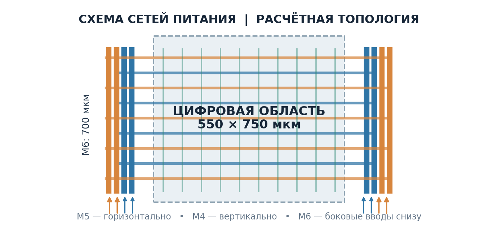

*Рисунок — Схема варианта 180 нм. Для исходного floorplan используйте контур цифровой области и боковые шины M6. Горизонтальные полосы M5 и вертикальные полосы M4 показывают сетку варианта B.*

#### Эксперимент 1. Подключение M1 к верхним шинам

1. Подключите локальные шины питания стандартных ячеек на M1 к соответствующим исходным боковым шинам верхнего металла.
2. Для перехода между слоями используйте допустимые **стеки vias через промежуточные слои**. Под «подключить M1 к верхнему металлу» не подразумевается один переход, пропускающий промежуточные слои. Локальные участки металла, необходимые для такого подключения, допускаются.
3. Дополнительную распределённую сетку полос внутри core в этом варианте не создавайте. Сети VDD и VSS должны оставаться раздельными и полностью подключёнными.
4. Завершите необходимые физические операции, выполните проверки связности и технологической корректности питания, получите базу и данные экстракции для **варианта A**.
5. Выполните статический power/rail analysis. Сохраните условия, мощность, токи, напряжения, состояние GUI и скриншоты.

#### Эксперимент 2. Подключение через сетку питания

1. На floorplan той же геометрии сохраните исходные верхние боковые шины и добавьте распределённые полосы питания внутри core.
2. Сформируйте сетку с путями в двух направлениях на подходящих слоях. Выберите и укажите слои, ширину и шаг полос. Соединения создавайте только между проводниками одной сети: VDD и VSS образуют электрически раздельные сети.
   Для варианта 180 нм начальные параметры M5 составляют 4 мкм по ширине и 50 мкм по шагу одноимённой сети. Для M4 начальная ширина составляет 2 мкм при том же шаге. Обоснуйте выбор по методике 180 нм и проверьте параметры металла и via definitions по PDK. [Расчёт сетки питания цифрового блока ASIC](doc/ASIC180_PDN_Full_Calculation_Methodology_RU.pdf).
3. Подключите сетку к исходным боковым шинам и локальным шинам M1 через допустимые via-соединения.
4. Завершите физические операции, повторите проверки и экстракцию для **варианта B**. Нельзя использовать паразитные параметры варианта A как актуальную модель изменённой реализации.
5. Выполните статический power/rail analysis и сохраните результаты отдельно от варианта A.

Исследуемый фактор — **топология сети питания**. Сохраните одинаковыми логический дизайн, размеры die/core, исходные верхние шины, точки подачи питания, библиотеки и PGV, view, напряжение, температуру, clocks, настройки активности и состояния управляющих сигналов. Изменение выходных каталогов служит только сохранению данных.

Если мощность или токи двух вариантов различаются, покажите это в отчёте и объясните возможное влияние изменений signal routing, нагрузок или состава ячеек. Не приписывайте всю разницу напряжений только PDN, не проверив условия нагрузки.

#### Сравнение вариантов

Откройте правильные power DB и rail states для A и B. Используйте одинаковые сети, слои просмотра, единицы и границы цветовой шкалы. Для каждого варианта покажите расположение источников и выбранную проблемную область.

| Показатель | Вариант A: подключение M1 к верхним шинам | Вариант B: питание через сетку |
|---|---|---|
| Слои и способ подключения | Заполнить | Заполнить |
| Ширина и шаг дополнительных полос | Указать отсутствие сетки; описать локальные подключения | Заполнить |
| Использованные via-соединения | Описать | Описать |
| Результат проверки связности питания | Заполнить | Заполнить |
| Суммарная мощность, в одинаковых единицах | Заполнить | Заполнить |
| Максимальное падение VDD, мВ | Заполнить | Заполнить |
| Максимальный подъём VSS, мВ | Заполнить | Заполнить |
| Минимальное локальное питание VDD−VSS и положение объекта | Заполнить | Заполнить |
| Заданный бюджет и результат сравнения с ним | Заполнить либо указать отсутствие предела | Заполнить либо указать отсутствие предела |
| Дополнительные ресурсы питания | Описать занятые слои и проводники | Описать занятые слои и проводники |

Объясните, как изменились пути доставки тока, роль сопротивлений металла и vias, положение областей просадки и затраты на дополнительные проводники. Обсудите, какие ресурсы для сигнальной трассировки занимает сетка.

Конкретное улучшение или заранее заданная кратность снижения IR drop не требуются. Нужно получить корректные результаты и объяснить фактическую разницу. Если разница мала, проверьте применение изменённой сети, условия нагрузки, точки питания и численные значения; одинаковые цвета при автоматической шкале сами по себе не подтверждают совпадение результатов.

#### Материалы для сдачи на «5»

- [ ] Все материалы базовой части на «4».
- [ ] Tcl самостоятельного построения floorplan и сохранённая исходная база, соответствующая рисунку.
- [ ] Две физические реализации: A с подключением локальных шин M1 к верхним боковым шинам и B с распределённой сеткой.
- [ ] Tcl формирования обоих вариантов питания и описание их геометрических параметров.
- [ ] Краткое обоснование ширины и шага сетки B: исходные токи, модель сопротивления, принятый бюджет и ограничения ручной оценки.
- [ ] Результаты проверки связности и технологической корректности питания.
- [ ] Базы, данные экстракции, логи, power/rail reports и состояния для обоих вариантов.
- [ ] Таблица сравнения с единицами и согласованными условиями анализа.
- [ ] Скриншоты топологии питания и сопоставимые карты напряжений с одинаковой шкалой.
- [ ] Объяснение наблюдаемой разницы и стоимости дополнительных ресурсов питания.

<a id="lab5-extra-questions"></a>

#### Дополнительные вопросы для защиты на «5»

Базовые вопросы также входят в защиту на «5».

1. Какие параметры floorplan были заданы рисунком и какие вы выбрали самостоятельно?
2. Как подключены шины M1 в варианте A? Почему для перехода на верхний металл нужен стек vias?
3. Как устроена сетка варианта B? Почему пересечения проводников разных сетей не должны создавать короткое замыкание VDD/VSS?
4. Как изменение ширины, шага полос и количества параллельных путей влияет на сопротивление сети?
5. Чем отличаются путь с наименьшим сопротивлением и эффективное сопротивление сети?
6. Почему локальное питание нужно оценивать с учётом как VDD, так и VSS?
7. Какие условия вы сохранили одинаковыми при сравнении? Какие различия появились после физического маршрута?
8. Почему после изменения сети нужно обновить её электрическую модель и не использовать прежние результаты экстракции?
9. Какова стоимость сетки: какие металлы, vias и ресурсы для сигнальной трассировки она использует?
10. Как изменились карты и численные результаты вашего проекта? Чем объясняется положение худшей области?
11. Почему более разветвлённая сеть не гарантирует заранее заданного улучшения при любых условиях?
12. Чем статическая оценка отличается от динамической и какие эффекты не охватывает выполненное сравнение?
13. Откуда в расчёте распределённой линии берутся коэффициенты $1/2$ и $1/8$? При каких условиях они применимы?
14. Почему ток блока делится между четырьмя M6 VDD, а не между всеми восемью шинами VDD/VSS? Как изменится деление при несимметричной нагрузке?
15. Почему геометрическое число cuts и выполнение IR-бюджета ещё не подтверждают DRC и EM?

<a id="lab5-extra-comparison"></a>

### 8.3. Дополнительные эксперименты и What-if

Изменение активности и What-if можно выполнить после сравнения физических вариантов A и B как самостоятельные эксперименты. [Задание на «5»](#lab5-grade5).

What-if analysis исследует изменение электрической модели, например масштабирование заданных токов или сопротивлений. Такой расчёт не заменяет физическое изменение топологии в Innovus.

При масштабировании токов в rail analysis прежний power report не превращается автоматически в отчёт новой логической активности. В выводах нужно указать, какая именно модель изменялась.

Для любого сравнения сохраняйте исходный вариант, изменяйте выбранный фактор, используйте разные каталоги результатов и одинаковую шкалу карт. Численная сводка нужна даже тогда, когда цветовые карты выглядят убедительно.

## Методическая основа

Рисунок для расчёта сетки 45 нм взят из предоставленного скриншота floorplan. [Рисунок топологии](#fig-lab5-pdn45-topology).

Подробный численный расчёт отдельного примера 180 нм приведён в методике преподавателя. [«Расчёт сетки питания цифрового блока ASIC. Cadence Innovus Stylus · 180 нм · M6 → M5 → M4 → M1»](doc/ASIC180_PDN_Full_Calculation_Methodology_RU.pdf).

Практическая последовательность подготовки библиотек, расчёта мощности и анализа сети питания опирается на **Cadence Rapid Adoption Kit — Power and Rail Analysis Using Voltus IC Integrity (Common UI), Voltus 20.10, июль 2020**.


Обоснование связи допустимой просадки с timing и условиями проекта: Kevin Kelley, Cadence Design Systems, [Using First Encounter and VoltageStorm to Optimize Peak IR drop or Power Mesh Area](https://citeseerx.ist.psu.edu/document?doi=5e1214e8d34770c360c450b8c5cf596320bba593&repid=rep1&type=pdf).
