# Лабораторная работа № 5. Анализ потребляемой мощности и сети питания в Cadence Voltus

В предыдущей работе вы выполнили placement, CTS и routing цифрового блока. Теперь проверим, как построенная сеть питания доставляет ток к ячейкам и какое напряжение они получают.

**Цель работы** — подготовить PGV, рассчитать среднюю потребляемую мощность и статический IR drop, научиться читать карты и отчёты Voltus и сохранять результаты для повторного просмотра.

На **«4»** используем готовый floorplan, проходим физический маршрут и выполняем статический анализ питания. На **«5»** самостоятельно строим floorplan по рисунку и сравниваем два способа подключения питания. Можно использовать свой проект, совместимый с учебным маршрутом, или предоставленный преподавателем дизайн. Динамический анализ включён как ознакомительный этап.

Примеры скриптов рассчитаны на **Voltus 20.10 Stylus Common UI**. В учебной конфигурации используются `s13207` и NanGate45. Полный прогон этой редакции в Voltus ещё предстоит проверить.

## Содержание

1. [Назначение анализа](#lab5-purpose)
2. [Основные понятия](#lab5-basics)
   - [Допустимое падение напряжения](#lab5-ir-limit)
3. [Послойный расчёт сети питания 45 нм](#lab5-pdn-calculation)
   - [Исходный floorplan](#lab5-pdn-inputs)
   - [Ток и потери на M9](#lab5-pdn-currents)
   - [Полосы M8](#lab5-pdn-m8)
   - [Участки M7](#lab5-pdn-m7)
   - [Переходы между слоями](#lab5-pdn-vias)
   - [Сквозная оценка](#lab5-pdn-summary)
   - [Ширина и шаг полос](#lab5-pdn-sizing)
   - [Итоговый вид и параметры для повторения](#lab5-pdn-final-view)
4. [Подготовка и запуск](#lab5-preparation)
5. [Практические этапы](#lab5-practice)
   - [Физическая реализация](#lab5-physical-flow)
   - [Генерация PGV](#lab5-pgv)
   - [Статический анализ](#lab5-static)
   - [Просмотр в GUI](#lab5-gui)
   - [Знакомство с динамическим анализом](#lab5-dynamic)
6. [Разбор результатов](#lab5-results)
7. [Сохранение данных](#lab5-save)
8. [Задания и защита](#lab5-assessment)

<a id="lab5-purpose"></a>

<a id="lab5-purpose"></a>

## 1. Назначение анализа

Питание поступает к ячейкам по металлическим проводникам и переходам между слоями. У них есть сопротивление. Когда по ним течёт ток, возникает падение напряжения. Поэтому напряжение питания ячейки может быть ниже заданного.

В **Voltus** выполняем два расчёта.

1. **Power analysis** — определяем, какую мощность потребляет схема и какие токи нужны ячейкам.
2. **Rail analysis** — по этим токам рассчитываем напряжения в сети питания.

<a id="fig-lab5-flow"></a>

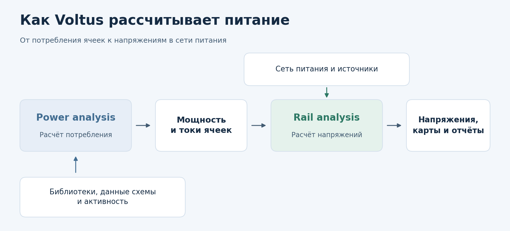

*Рисунок — Сначала рассчитываем потребление схемы, затем напряжения в её сети питания.*

Результат зависит от выбранных библиотек, напряжения, температуры, активности и расположения источников. Эти настройки сохраняем вместе с отчётами.

## 2. Основные понятия

### 2.1. Сеть питания

**Сеть питания (PDN — Power Distribution Network)** — это металлические проводники и переходы между слоями, которые соединяют источник питания с ячейками схемы.

В работе используем две сети.

- **VDD** — сеть питания. По ней ток поступает от источника к ячейкам.
- **VSS** — земля. По ней ток возвращается от ячеек к источнику.

У источника потенциал VSS принимаем равным **0 В**. Питание блока во время работы постоянно включено.

<a id="fig-lab5-pdn-basics"></a>

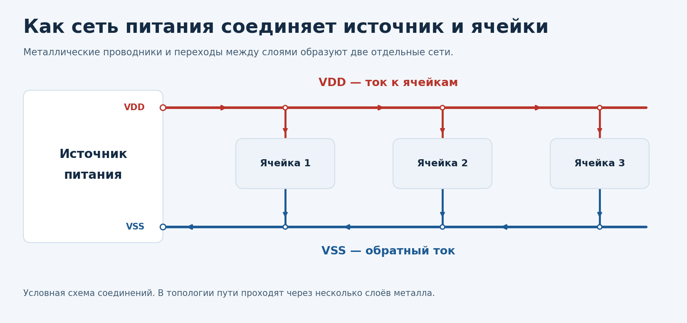

*Рисунок — По VDD ток поступает к ячейкам, а по VSS возвращается к источнику.*

В примере 45 нм питание подаётся снизу на боковые шины **M9**. Далее ток проходит через **M8, M7**, нижние слои и переходы к ячейкам. Общий вид этой сетки показан на [итоговом рисунке](#fig-lab5-pdn45-final).
### 2.2. Падение напряжения

Когда по проводнику течёт ток, на его сопротивлении возникает **падение напряжения**. Его рассчитываем по закону Ома.

$$
\Delta V=IR,
$$

где $I$ — ток через участок, а $R$ — сопротивление этого участка.

У ячейки напряжение **VDD снижается**, а **VSS повышается** относительно источника. Оба изменения уменьшают питание ячейки. Поэтому учитываем разность напряжений на её выводах.

$$
V_{\text{cell}}=VDD_{\text{local}}-VSS_{\text{local}}.
$$

Например, источник задаёт VDD = **1,1 В** и VSS = **0 В**. Если у ячейки VDD = **1,08 В**, а VSS = **0,01 В**, она получает **1,07 В**. Общая потеря составляет **30 мВ** — 20 мВ на VDD и 10 мВ на VSS.

<a id="fig-lab5-ir-drop-basics"></a>

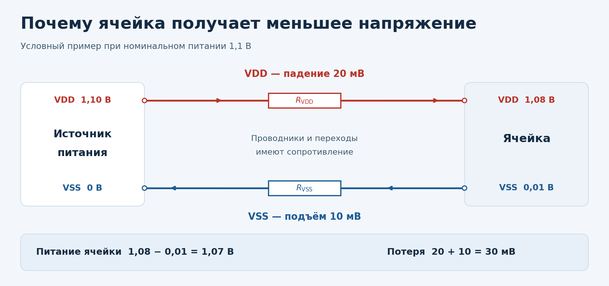

*Рисунок — При номинальном питании 1,1 В ячейка получает 1,07 В. Потери на VDD и VSS складываются.*

При снижении питания задержки ячеек обычно увеличиваются. Большая просадка может привести к ошибкам в работе схемы.

<a id="lab5-ir-limit"></a>

### 2.3. Допустимое падение напряжения

**Допустимое падение напряжения, или IR-drop budget,** — это предел, на который питание ячейки может уменьшиться относительно номинального.

Для учебного примера зададим допустимую потерю **2% от 1,1 В**.

$$
\Delta V_{\text{lim}}=1{,}1\cdot0{,}02=0{,}022\;\text{В}=22\;\text{мВ}.
$$

Значит, напряжение питания ячейки **VDD−VSS должно быть не ниже 1,078 В**. Этот предел учитывает вместе падение VDD и подъём VSS.

В примере из §2.2 ячейка получала **1,07 В**, а потеря составляла **30 мВ**. При выбранном пределе **22 мВ** такая просадка превышает допустимую.

<a id="fig-lab5-ir-budget-basics"></a>

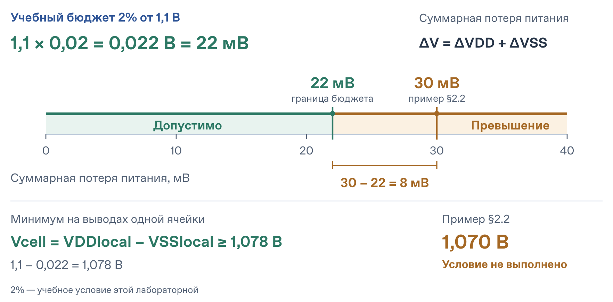

*Рисунок — Допустимая потеря 22 мВ соответствует минимальному питанию ячейки 1,078 В.*

При проверке берём VDD и VSS **одной и той же ячейки**. В динамическом анализе также учитываем время и выбранную метрику.

Порог может задаваться для суммарного питания ячейки или отдельно для VDD и VSS. Перед расчётом укажите, что именно проверяете. **2% здесь — учебное условие.** В своём проекте предел выбирают по требованиям к питанию и работе схемы. Порядок проверки приведён в [§6.3](#lab5-ir-limit-check).

### 2.4. Состав потребляемой мощности

В отчёте Voltus мощность делится на три составляющие.

| Составляющая | Что описывает |
|---|---|
| **Internal power** | Переключения внутри ячейки — заряд внутренних ёмкостей и кратковременный ток между VDD и VSS |
| **Switching power** | Заряд и разряд нагрузки на выходе ячейки — проводников и входов следующих ячеек |
| **Leakage power** | Токи утечки, которые есть и тогда, когда сигналы не переключаются |

<a id="fig-lab5-power-components"></a>

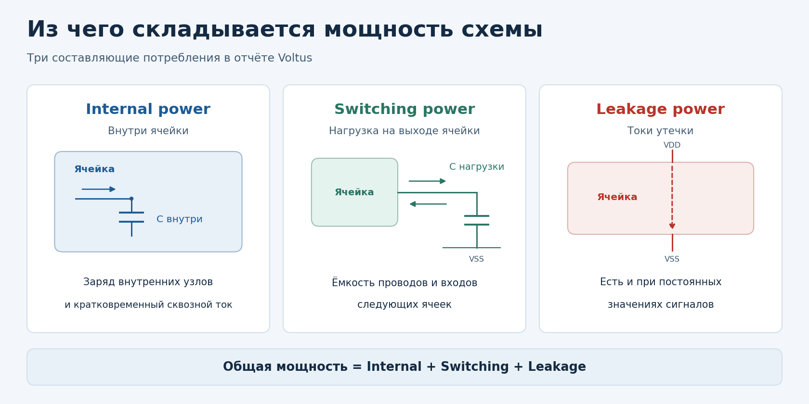

*Рисунок — Три составляющие потребляемой мощности.*

Сумма этих составляющих даёт **общую мощность**.

$$
P_{\text{total}}=P_{\text{internal}}+P_{\text{switching}}+P_{\text{leakage}}.
$$

Для оценки среднего тока при одном напряжении питания используем $I\approx P_{\text{total}}/U$. Перед подстановкой чисел проверьте единицы мощности в заголовке отчёта.

### 2.5. Активность переключений

**Активность переключений** показывает, как часто сигнал меняется с 0 на 1 и обратно. При одинаковых ёмкости и напряжении больше переключений за одно и то же время означает больше затрат энергии на заряд и разряд нагрузки.

<a id="fig-lab5-switching-activity"></a>

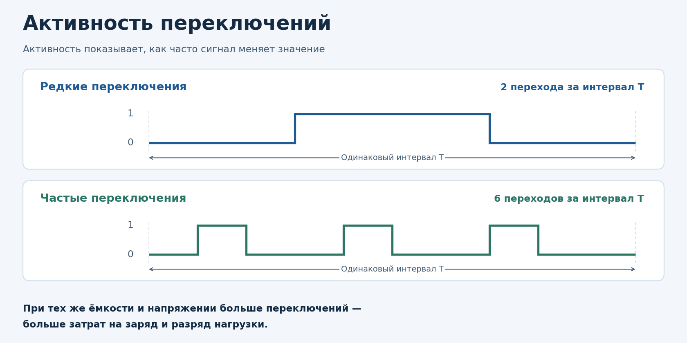

*Рисунок — Два сигнала с разной активностью за одинаковый интервал времени.*

В учебных скриптах используется **оценочная активность**. Её задаёт команда `set_default_switching_activity`, затем `propagate_activity` распространяет активность по схеме. На этой основе Voltus оценивает потребление.

В Makefile настройте три параметра.

| Переменная | Что задаёт |
|---|---|
| `VOLTUS_INPUT_ACTIVITY` | Оценочную активность входных сигналов |
| `VOLTUS_ACTIVITY_PERIOD` | Период, к которому относится заданная активность |
| `VOLTUS_CLOCK_GATE_RATIO` | Коэффициент активности на выходах элементов clock gating |

Период задаётся в единицах времени Liberty. Тактовые сигналы берутся из SDC восстановленной базы проекта.

Reset и другие управляющие сигналы должны соответствовать выбранному режиму работы. Например, при анализе обычной работы схемы **сброс должен быть неактивен**.
### 2.6. Статический и динамический анализ

В обоих случаях Voltus рассчитывает напряжения в сети питания. Разница — в токах, которые используются для расчёта.

| Анализ | Токи нагрузки | Что показывает |
|---|---|---|
| **Статический** | Средние токи ячеек | Падение напряжения при среднем потреблении |
| **Динамический** | Токи ячеек, меняющиеся во времени | Изменение напряжения и кратковременные просадки |

<a id="fig-lab5-static-dynamic"></a>

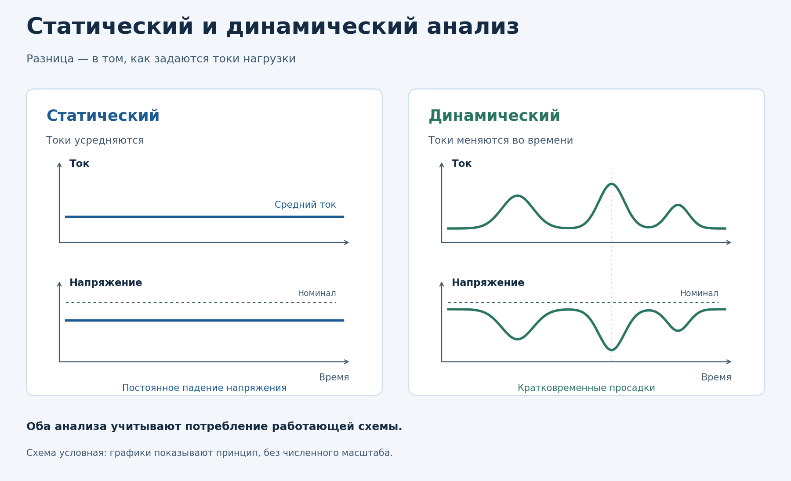

*Рисунок — Условное сравнение статического и динамического анализа в одной точке сети питания.*

**Статический анализ** учитывает internal, switching и leakage power. Он учитывает потребление при переключениях, но усредняет его и не показывает отдельные кратковременные просадки.

**Динамический анализ** позволяет увидеть, что происходит в отдельные моменты времени. Например, при одновременном переключении многих ячеек ток может резко вырасти, а напряжение — снизиться. Такая просадка может быть больше, чем при расчёте по среднему току.

В учебном динамическом скрипте используется режим `dynamic_vectorless`. Voltus оценивает события переключений по заданной активности и временным характеристикам схемы, без файла переключений из моделирования.
### 2.7. Для чего нужна PGV

**PGV — Power Grid View** — библиотека для расчёта сети питания. Она описывает подключения ячеек к VDD и VSS и точки, в которых к сети прикладываются токи ячеек. Сами токи рассчитываются на этапе **power analysis**.

В учебном маршруте создаётся упрощённая библиотека **technology-only** — `techonly.cl`. Для её генерации используются **LEF** и **QRC technology**: LEF задаёт физическую геометрию, а QRC technology — данные для расчёта электрических параметров проводников и переходов.

В этой модели ячейка представлена выводами питания, к которым прикладывается её ток. **Подробная сеть питания внутри ячейки не моделируется.**

<a id="fig-lab5-pgv-basics"></a>

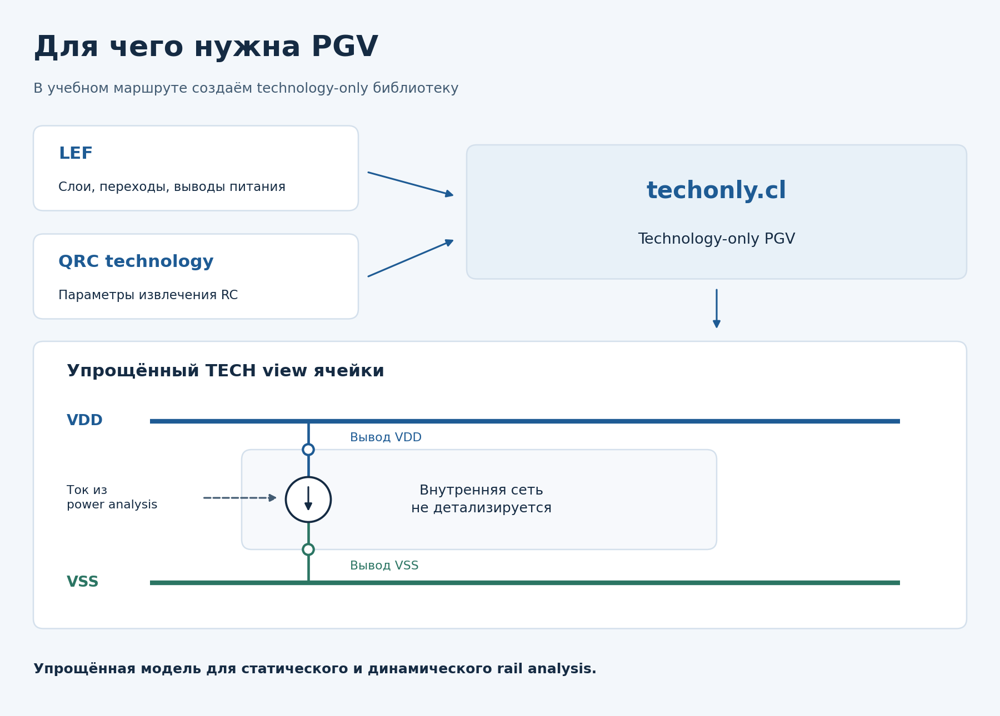

*Рисунок — Упрощённое представление ячейки при использовании technology-only PGV. Ток поступает из результатов power analysis.*

Библиотека `techonly.cl` используется в статическом и динамическом анализе. Динамический запуск в этой работе служит знакомством с расчётом. Для точной оценки влияния развязывающих ёмкостей **decap** нужны характеризованные ёмкостные модели этих ячеек.

<a id="lab5-pdn-calculation"></a>## 3. Послойный расчёт сети питания блока 45 нм

Питание подаётся снизу на боковые шины M9. Начнём с расчёта потерь на этих шинах. Напряжения на M9 в точках отвода зададут условия питания для полос M8. После M8 перейдём к M7.

<a id="fig-lab5-pdn45-abstract"></a>

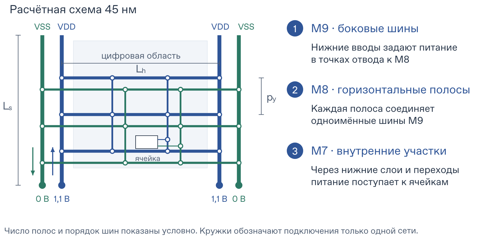

*Рисунок — Расчётная схема по floorplan. Участок ① показывает боковую шину, ② — горизонтальную полосу, ③ — соединение с ячейкой. Разводка VDD/VSS и число полос показаны условно. $L_s$ — длина боковой шины от нижнего ввода, $L_h$ — пролёт горизонтальной полосы, $p_y$ — шаг соседних горизонталей одной сети.*

<a id="lab5-pdn-inputs"></a>

### 3.1. Исходный floorplan и параметры M9

По бокам цифровой области проходят исходные шины M9. Ток VDD идёт от нижних точек подачи вверх к отводам. По шинам VSS ток возвращается к нижним точкам подключения земли.

<a id="fig-lab5-pdn45-topology"></a>

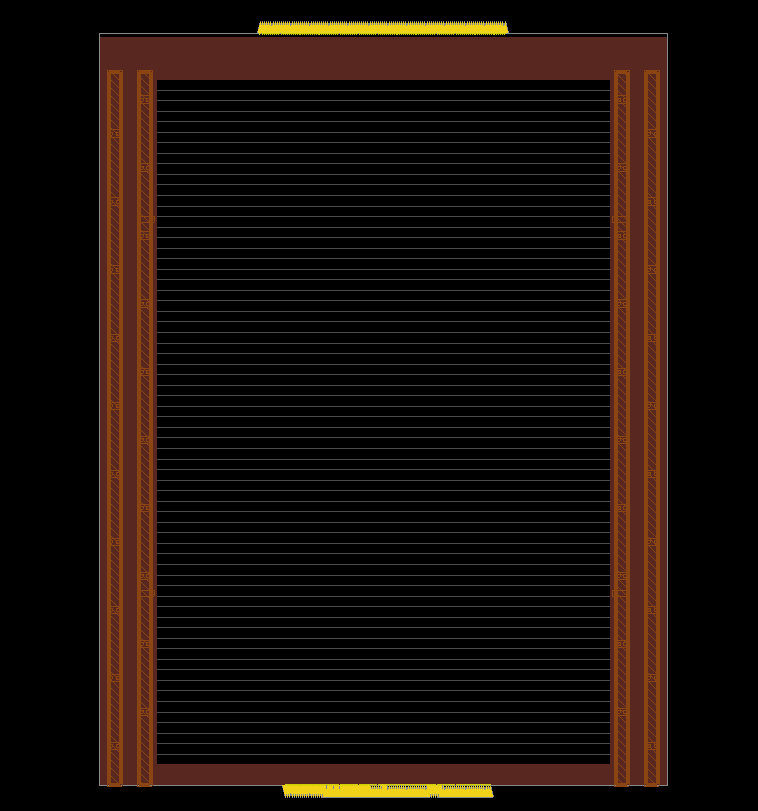

*Рисунок — Исходный floorplan блока 45 нм. Слева и справа расположены по две шины M9.*

| Параметр | Значение |
|---|---|
| Цифровая область (core) | 60 × 91 мкм |
| Кристалл (die) | 75 × 100 мкм |
| Длина одной шины M9 | 95 мкм |
| Ширина одной шины M9 | 2 мкм |
| Номинальные потенциалы источников | VDD = 1,1 В, VSS = 0 В |
| Сопротивление квадрата M9 | 0,030 Ом/□ по FreePDK45 для предварительной оценки |

Для сопротивления шины используем её длину **95 мкм**. Площадь core **5460 мкм²** пригодится позже для оценки нагрузки внутренних полос. Справочное сопротивление квадрата сверяем с tech LEF или моделью экстракции своего PDK. [Таблица металлизации FreePDK45](https://eda.ncsu.edu/freepdk/freepdk45/).

Учебный бюджет на суммарную потерю между VDD и VSS составляет **2%** от номинального питания.

$$
\Delta V_{\mathrm{lim}}=1{,}1\cdot0{,}02=0{,}022\;\text{В}=22\;\text{мВ}.
$$

<a id="lab5-pdn-currents"></a>

### 3.2. Средний ток блока и ток в боковых шинах M9

Из отчёта `static.rpt` берём `Total Power` = **0,62491942**. В примере считаем, что мощность указана в мВт. Единицы сверяем со строкой `Power Units` в заголовке отчёта. При питании 1,1 В средний ток блока равен

$$
I_{\mathrm{block}}\approx\frac{P}{U}
=\frac{0{,}62492\;\text{мВт}}{1{,}1\;\text{В}}
\approx 0{,}5681\;\text{мА}.
$$

При симметричной нагрузке половина тока идёт по каждой из двух шин VDD. Тот же ток возвращается по двум шинам VSS, также поровну. Поэтому ток у нижнего конца каждой боковой шины составляет **0,2841 мА**.

<a id="fig-lab5-m9-current-split"></a>

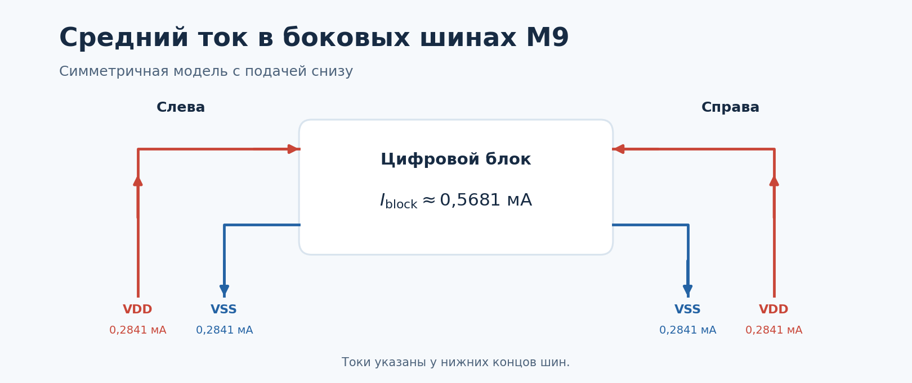

*Рисунок — Подача тока через две шины VDD и возврат через две шины VSS.*

### 3.3. Сопротивление одной боковой шины M9

Сопротивление проводника считаем по формуле $R=\rho L/S$, где $L$ — длина, $\rho$ — удельное сопротивление, а $S=wt$ — площадь сечения. Для металла фиксированной толщины $t$ удобно взять сопротивление квадрата $R_\square=\rho/t$ из данных технологии.

<a id="fig-lab5-m9-sheet-resistance"></a>

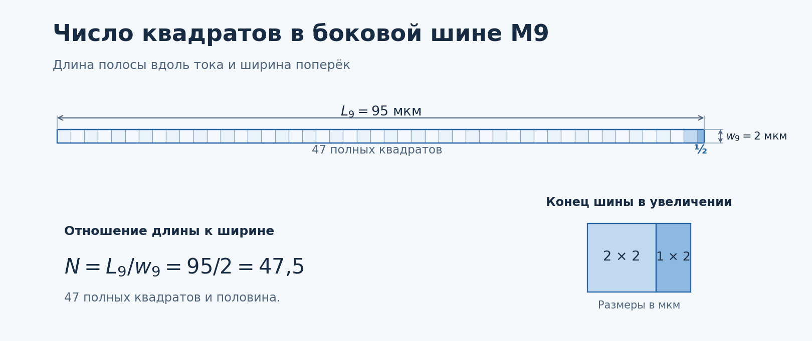

*Рисунок — Условное деление шины M9 на квадраты вдоль тока.*

В шине длиной 95 мкм и шириной 2 мкм помещается 47,5 квадрата. Сопротивление одной шины составляет

$$
R_9=R_\square\frac{L}{w}
=0{,}030\;\text{Ом/□}\cdot47{,}5
=\mathbf{1{,}425\;\text{Ом}}.
$$

### 3.4. Потеря напряжения на M9

Представим, что нагрузка распределена равномерно вдоль шины. Внизу через шину проходит 0,2841 мА, в середине остаётся половина этого тока, а к верхнему концу ток уменьшается до нуля. Для участка шины берём среднее между токами на его концах.

<a id="fig-lab5-m9-drop-profile"></a>

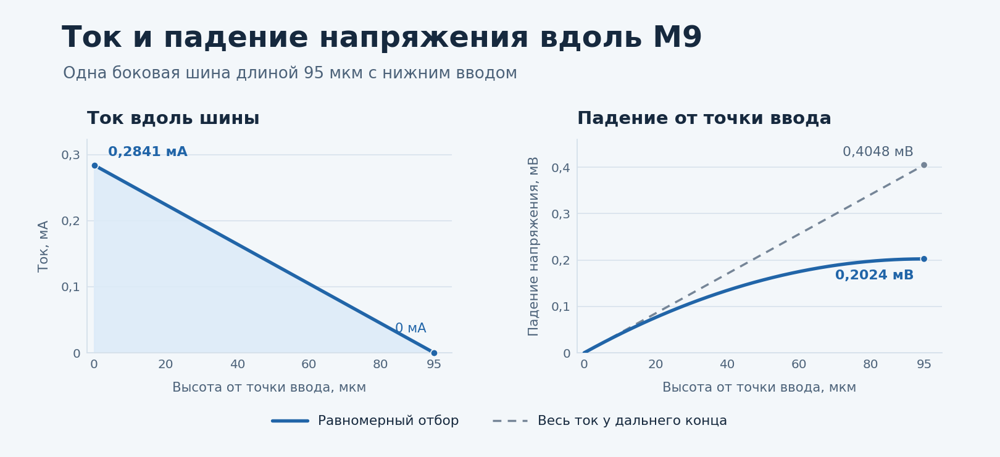

*Рисунок — Сплошная линия показывает равномерную нагрузку вдоль M9. Пунктир на правом графике показывает, каким было бы падение при той же нагрузке, сосредоточенной на верхнем конце.*

Средний ток по всей длине шины равен половине входного. По закону Ома получаем потерю от нижнего ввода до верхнего конца одной шины

$$
\Delta V=I_{\text{ср}}R
\approx\frac{0{,}2841\;\text{мА}}{2}\cdot1{,}425\;\text{Ом}
\approx 0{,}2024\;\text{мВ}.
$$

На верхнем конце VDD падает на 0,2024 мВ, а VSS поднимается на те же 0,2024 мВ. Поэтому разность VDD−VSS уменьшается примерно на **0,4048 мВ**. Пока мы учли только боковые шины M9.

<a id="lab5-pdn-estimate"></a>

### 3.5. Напряжение в точках подключения M8 к M9

Горизонтальная полоса M8 подключается к боковым шинам M9. Возьмём для примера отвод посередине M9, на высоте **47,5 мкм** от нижней точки подачи.

На нижней половине шины сопротивление вдвое меньше полного и равно **0,7125 Ом**. При равномерной нагрузке к середине шины нижние отводы забирают половину тока. На участке ток убывает с 0,2841 мА до примерно 0,142 мА, поэтому средний ток составляет **0,213 мА**. Снова применяем закон Ома.

$$
\Delta V\approx 0{,}213\;\text{мА}\cdot0{,}7125\;\text{Ом}
\approx 0{,}1518\;\text{мВ}.
$$

На эту величину потенциал VDD понижается, а потенциал VSS повышается.

| Величина в точке отвода | Значение |
|---|---:|
| Потенциал VDD на M9 | 1,099848 В |
| Потенциал VSS на M9 | 0,000152 В |
| Разность VDD−VSS | 1,099696 В |
| Потеря питания к этой высоте | **0,3036 мВ** |

<a id="fig-lab5-m9-m8-tap"></a>

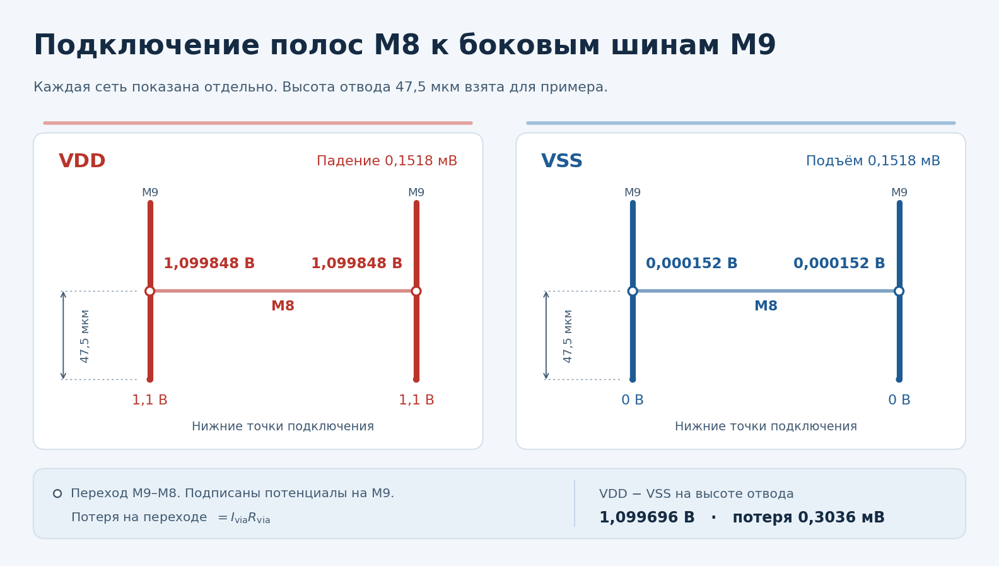

*Рисунок — Подключение M8 к M9 при симметричной нагрузке. VDD и VSS показаны раздельно. Кружки на высоте отвода обозначают переходы M9–M8.*

На рисунке указаны потенциалы на M9 перед переходами. Потерю на каждом переходе считаем отдельно, умножая ток через переход на его сопротивление. При одинаковых потенциалах на M9 и одинаковых потерях на переходах потенциалы концов полосы M8 будут равны.

Для расчёта M8 понадобятся **пролёт между подключениями к M9**, **ширина полосы** и **шаг между соседними полосами одной сети**. Пролёты VDD и VSS измеряем отдельно.

<a id="lab5-pdn-m8"></a>

### 3.6. Падение напряжения вдоль полосы M8

Горизонтальная полоса VDD на M8 подключена к боковым шинам M9 слева и справа. Возьмём для примера **10 полос VDD** с шагом **9,1 мкм** по высоте цифровой области. Пролёт одной полосы между переходами на M9 примем равным **64 мкм**, ширину — **0,8 мкм**. Это учебные размеры. Для своего floorplan берём размеры из Innovus.

<a id="fig-lab5-m8-stripe"></a>

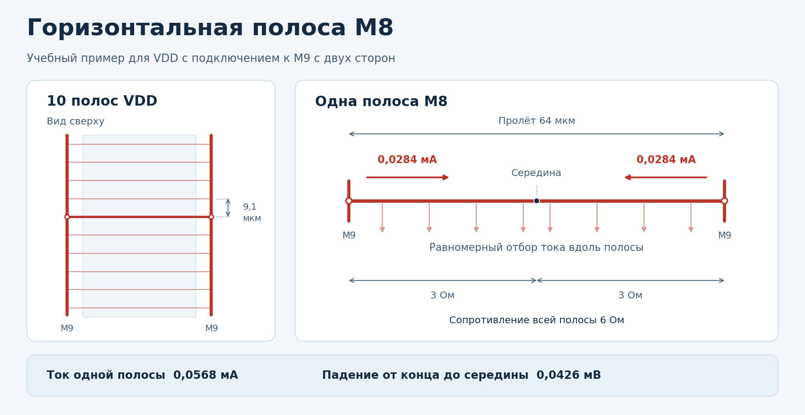

*Рисунок — Полосы VDD на M8 и токи на концах одной полосы. Точки подключения к M9 отмечены кружками.*

**Ток.** При равномерной нагрузке на одну полосу приходится десятая часть тока блока. Делим 0,5681 мА на 10 и получаем **0,0568 мА**. При одинаковых потенциалах на концах и симметричной нагрузке каждый конец отдаёт в полосу половину этого тока, **0,0284 мА**.

**Сопротивление.** Для M8 по FreePDK45 берём 0,075 Ом/□. По формуле из §3.3 получаем $R_8=0{,}075\cdot64/0{,}8=6$ Ом. От конца полосы до середины сопротивление вдвое меньше, **3 Ом**. [Таблица металлизации FreePDK45](https://eda.ncsu.edu/freepdk/freepdk45/).

**Падение напряжения.** Каждая сторона питает свою половину полосы. При равномерном отборе вдоль полосы ток в половине убывает от 0,0284 мА у конца до нуля в середине. Средний ток на этом участке — **0,0142 мА**. Умножаем его на сопротивление участка.

$$
\Delta V_8\approx 0{,}0142\;\text{мА}\cdot3\;\text{Ом}
=\mathbf{0{,}0426\;\text{мВ}}.
$$

На середине полосы VDD ниже, чем на её концах, на **0,0426 мВ**. Чтобы получить потерю от нижнего ввода до этой точки, к вкладу M8 добавляем потерю на M9 до отвода и падение на переходе M9–M8. Через каждый переход в этом примере проходит 0,0284 мА.

При той же нагрузке меньший шаг уменьшает ток на одну полосу, а большая ширина уменьшает её сопротивление. Для VSS применяем тот же расчёт с размерами её полос.

<a id="lab5-pdn-m7"></a>

### 3.7. Падение напряжения на участке M7

Вертикальные полосы VDD на M7 соединяются с горизонтальными полосами VDD на M8 через переходы. Рассмотрим один внутренний участок M7 между соседними полосами M8. Его длина равна шагу M8, **9,1 мкм**. Для учебного примера примем **ширину M7 0,8 мкм** и **шаг M7 6 мкм** между полосами VDD.

<a id="fig-lab5-m7-segment"></a>

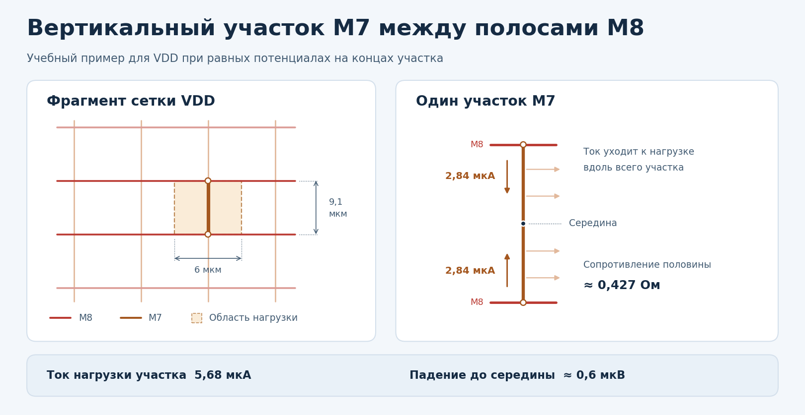

*Рисунок — Нагрузка участка M7 и подача тока с двух концов при равных потенциалах. Кружками показаны переходы M8–M7 на концах выбранного участка.*

**Ток.** При равномерной нагрузке участок обслуживает прямоугольник **6 × 9,1 мкм**. Это 1% площади цифровой области 60 × 91 мкм. Значит, на участок приходится 1% тока блока, или **5,68 мкА**.

**Сопротивление.** Для M7 по FreePDK45 берём 0,075 Ом/□. Весь участок имеет сопротивление $0{,}075\cdot9{,}1/0{,}8\approx0{,}853$ Ом. От конца до середины получаем **0,427 Ом**. [Таблица металлизации FreePDK45](https://eda.ncsu.edu/freepdk/freepdk45/).

**Падение напряжения.** Для ручной оценки примем одинаковые потенциалы на обоих концах и равномерный отбор тока вдоль участка. Тогда каждый конец подаёт **2,84 мкА**. Ток убывает до нуля в середине, поэтому средний ток вдоль половины участка равен **1,42 мкА**.

$$
\Delta V_7 \approx 1{,}42\;\text{мкА}\cdot 0{,}427\;\text{Ом}
\approx \mathbf{0{,}6\;\text{мкВ}}.
$$

Это локальное падение в металле M7 от конца до середины участка. В реальной сетке соседние M8 подключены к M9 на разных высотах, поэтому потенциалы на концах M7 могут отличаться и ток будет делиться иначе. Voltus учитывает такое перераспределение и сопротивления переходов при расчёте всей сетки.

<a id="lab5-pdn-vias"></a>

### 3.8. Падение напряжения на переходах между слоями

Чтобы посчитать падение на переходе, умножаем **ток через весь переход** на его сопротивление. Находим этот ток по тому, какие участки питаются через данную точку.

- **M9 → M8.** Через переход у одного конца полосы M8 в примере из §3.6 проходит **28,4 мкА**. Второй конец полосы получает свою долю тока через отдельный переход.
- **M8 → M7.** Во внутреннем пересечении ток после перехода расходится по M7 в обе стороны. В симметричном примере из §3.7 в каждый соседний участок идёт **2,84 мкА**. Значит, через переход проходит **5,68 мкА**.

<a id="fig-lab5-pg-vias"></a>

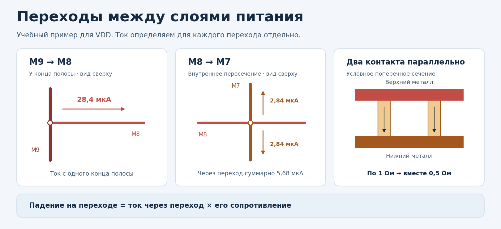

*Рисунок — Кружками на видах сверху обозначены переходы между слоями. Справа показано, как два контакта соединяют одни и те же слои.*

Для учебной оценки примем сопротивление одного контакта (**via cut**) равным **1 Ом**. Два одинаковых контакта между теми же слоями соединены параллельно. Их общее сопротивление в этой модели равно **0,5 Ом**.

| Переход | Ток через переход | Падение при одном контакте | Падение при двух контактах |
|---|---:|---:|---:|
| M9 → M8 у одного конца полосы | 28,4 мкА | 28,4 мкВ | 14,2 мкВ |
| M8 → M7 во внутреннем пересечении | 5,68 мкА | 5,68 мкВ | 2,84 мкВ |

Для сравнения в таблице ток через переход оставляем тем же. В реальной разводке число контактов зависит от размера площадки и правил технологии, а сопротивление перехода берём из модели экстракции.

<a id="lab5-pdn-summary"></a>

### 3.9. От ручной оценки к проверке в Voltus

Оценим VDD в середине участка M7 между двумя соседними полосами M8. Сначала найдём характерный потенциал в середине M8. Возьмём высоту отвода **47,5 мкм** из §3.5, симметричную подачу с двух сторон и один контакт сопротивлением **1 Ом** на каждом переходе. По одному подводу до середины M8 получаем **0,2228 мВ** падения, или **1,0997772 В** при напряжении ввода 1,1 В.

Для ручной оценки примем, что оба пересечения M8 с выбранной полосой M7 имеют этот потенциал. Это приближение для двух соседних подводов. В реальной сетке их потенциалы зависят от положения и нагрузки.

<a id="fig-lab5-pdn-summary"></a>

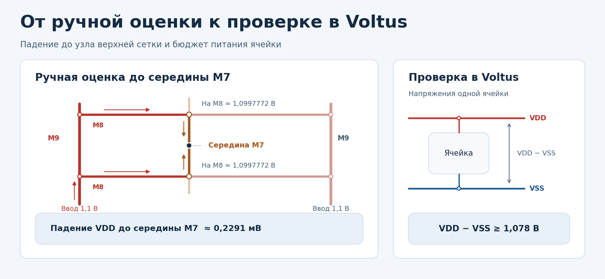

*Рисунок — Слева путь от нижних вводов до середины M7, справа критерий для питания ячейки в Voltus.*

| Участок выбранного подвода | Падение VDD |
|---|---:|
| По M9 от нижнего ввода до отвода на M8, §3.5 | 0,1518 мВ |
| На одном переходе M9–M8, §3.8 | 0,0284 мВ |
| По M8 от конца полосы до середины, §3.6 | 0,0426 мВ |
| **От ввода до середины M8** | **0,2228 мВ** |
| На одном переходе M8–M7, §3.8 | 0,00568 мВ |
| По M7 от конца участка до середины, §3.7 | 0,0006 мВ |
| **От ввода до середины M7** | **≈ 0,2291 мВ** |

На каждом переходе M8–M7 теряем **5,68 мкВ**. Поэтому напряжение на обоих концах участка M7 составляет примерно **1,0997715 В**. От любого конца до середины теряем ещё **0,6 мкВ** и получаем **около 1,0997709 В**. Падения по двум подводам равны, поскольку оба ведут от одинакового напряжения ввода к одной точке M7.

**Проверка в Voltus.** Ручная оценка доведена до точки M7. В Voltus учитываем всю сеть до выводов ячеек. Для каждой ячейки берём её локальные VDD и VSS и вычисляем разность. При номинале **1,1 В** и бюджете потерь **22 мВ** минимальное значение VDD−VSS по ячейкам должно быть **не ниже 1,078 В**.

<a id="lab5-pdn-sizing"></a>

### 3.10. Как подобрать ширину и шаг полос

Возьмём исходную сетку M8 из §3.6. Сравним два изменения по отдельности. Сохраним ток блока, пролёт полос **64 мкм** и те же допущения о равномерной нагрузке и подаче питания с двух сторон. Шаг измеряем между соседними полосами **VDD**.

<a id="fig-lab5-m8-sizing"></a>

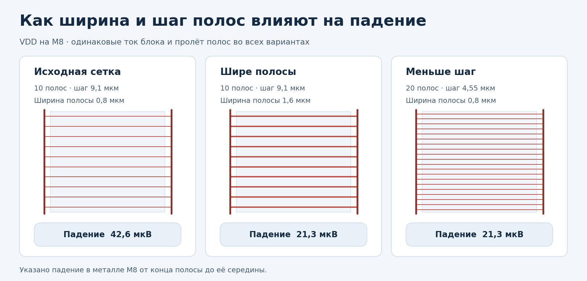

*Рисунок — Сравнение падения в металле M8 от конца полосы до её середины.*

| Параметр | Исходная сетка | Полосы вдвое шире | Шаг вдвое меньше |
|---|---:|---:|---:|
| Число полос VDD | 10 | 10 | 20 |
| Ширина полосы | 0,8 мкм | 1,6 мкм | 0,8 мкм |
| Шаг полос VDD | 9,1 мкм | 9,1 мкм | 4,55 мкм |
| Ток одной полосы | 56,8 мкА | 56,8 мкА | 28,4 мкА |
| Сопротивление всей полосы | 6 Ом | 3 Ом | 6 Ом |
| **Падение от конца до середины M8** | **42,6 мкВ** | **21,3 мкВ** | **21,3 мкВ** |

У широкой полосы вдвое меньше сопротивление. При меньшем шаге нагрузка делится между вдвое большим числом полос, поэтому ток каждой полосы вдвое меньше. В обоих случаях падение в металле M8 уменьшается вдвое.

Оба варианта занимают вдвое больше площади металла VDD на M8. Меньший шаг M8 также сокращает участки M7 между соседними подключениями. При выборе варианта учитываем место для полос VSS, переходов и сигнальной трассировки. После построения сетки проверяем правила технологии и оцениваем в Voltus питание ячеек по критерию из §3.9.

<a id="lab5-pdn-final-view"></a>

### 3.11. Как выглядит сеть питания после расчёта

Покажем базовый вариант сетки из §3.1, §3.6 и §3.7. Питание подаётся снизу на боковые шины M9. От них горизонтальные полосы M8 распределяют ток поперёк блока, а вертикальные полосы M7 разносят питание вдоль него.

<a id="fig-lab5-pdn45-final"></a>

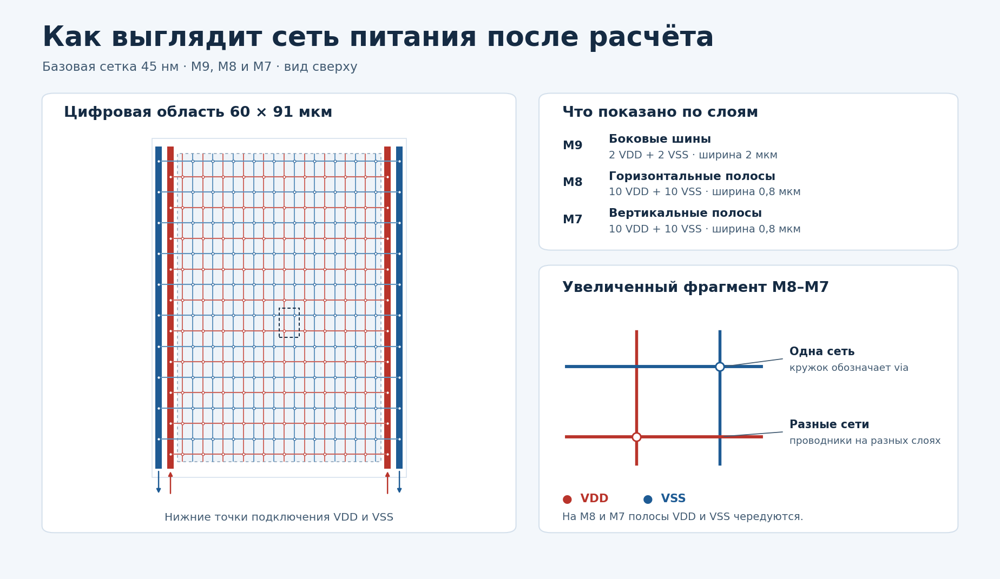

*Рисунок — Базовая сетка M9–M8–M7. Красным показана VDD, синим — VSS. Кружками обозначены переходы между проводниками одной сети.*

#### Параметры для повторения в Innovus

Размер кристалла (die) **75 × 100 мкм**, цифровой области (core) **60 × 91 мкм**. Начните с количества и ширины полос на каждом слое.

| Слой | Направление | VDD | VSS | Ширина одной полосы |
|---|---|---:|---:|---:|
| **M9** | Вертикальные боковые шины | 2 | 2 | 2 мкм |
| **M8** | Горизонтальные полосы | 10 | 10 | 0,8 мкм |
| **M7** | Вертикальные полосы | 10 | 10 | 0,8 мкм |

1. **M9.** Разместите слева и справа по одной шине VDD и VSS длиной **95 мкм**. На рисунке VSS ближе к краю кристалла, VDD — к core.
2. **M8.** Разместите **10 пар VDD/VSS** равномерно по высоте core. Шаг между соседними парами **9,1 мкм**. Полосы VDD и VSS чередуются с интервалом в половину этого шага. Доведите каждый конец полосы до боковой шины M9 своей сети с перекрытием для перехода.
3. **M7.** Разместите **10 пар VDD/VSS** равномерно по ширине core с шагом **6 мкм** между парами. Полосы VDD и VSS чередуются с интервалом в половину шага и проходят на всю высоту core.

Поставьте переходы в местах пересечения металла одной сети. Для M9–M8 получится **20 мест на сеть**, для M8–M7 — **100 мест на сеть**. Подберите типы переходов и число cuts по PDK, затем проверьте DRC и связность VDD и VSS.

Для анализа в Voltus расположите по одной точке подачи внутри нижнего конца каждой шины M9. Возьмите их координаты из построенного floorplan и запишите в файлы по формату §4.6.

Для скриншота откройте вид сверху и впишите весь die в окно. Оставьте видимыми контуры die и core, M7, M8, M9 и переходы между ними. Выделите VDD и VSS разными цветами. На общем виде покажите четыре боковые шины и всю сетку, а на увеличенном фрагменте — переход одной сети и соседнее пересечение VDD с VSS.

<a id="lab5-preparation"></a>

## 4. Подготовка и запуск

<a id="lab5-project-choice"></a>

### 4.1. Выбор проекта

Используйте готовый учебный дизайн преподавателя или собственный проект из предыдущих лабораторных. Для своего проекта подготовьте совместимые RTL или netlist, ограничения, библиотеки и физические данные.

| Оценка | Исходные данные | Что выполняем |
|---|---|---|
| **«4»** | Дизайн, готовый floorplan и управляющие файлы маршрута | Проходим placement, CTS и routing, затем анализируем питание |
| **«5»** | Те же модели и дизайн, рисунок исходного floorplan | Самостоятельно строим floorplan и сравниваем два варианта питания |

К началу анализа Voltus должна восстанавливаться база после routing с подключённым питанием, корректными clocks и доступными библиотеками. Состояния управляющих входов и активность должны соответствовать выбранному режиму.

<a id="lab5-voltus-inputs"></a>

### 4.2. Необходимые данные

Сохраните **физическую базу после routing** и **сигнальный SPEF** из одного прогона Innovus. По базе Voltus восстанавливает размещение и геометрию сети питания. Сигнальный SPEF содержит паразитные параметры межсоединений для расчёта мощности.

<a id="fig-lab5-voltus-inputs"></a>

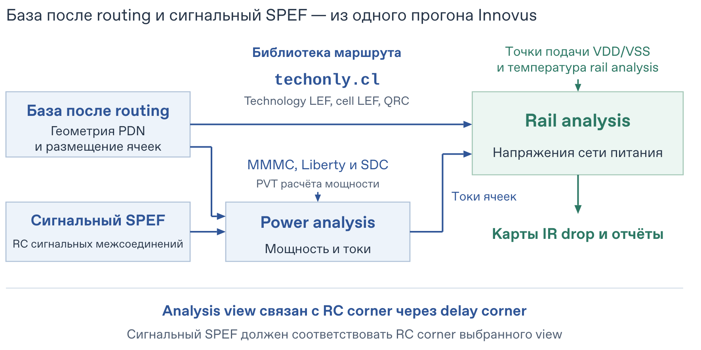

*Рисунок — Подготовка PGV, получение токов на этапе power analysis и расчёт напряжений на этапе rail analysis.*

| Откуда берём | Что понадобится | Что проверить |
|---|---|---|
| Из Innovus | База после routing и один сигнальный SPEF | Файлы относятся к одному проекту и одной версии разводки. SPEF соответствует выбранному RC corner |
| Из PDK и библиотек | Технологический LEF, LEF ячеек, технология экстракции QRC и карта слоёв, если она нужна | При генерации PGV технологический LEF стоит первым. При восстановлении базы доступны её MMMC, Liberty и SDC |
| Из настроек проекта | Analysis view, RC corner, напряжение, температура, активность и два файла точек подачи VDD/VSS | Имена view и corner взяты из MMMC. Точки подачи попадают на проводники нужной сети и слоя, см. §4.6 |

Сначала выполните `make voltus.pgv`, чтобы получить **`techonly.cl`**. Эту библиотеку используют оба этапа в `voltus.static` и `voltus.dynamic`. **Power analysis** рассчитывает мощность и записывает токи. **Rail analysis** читает полученные токи, учитывает точки подачи и рассчитывает напряжения в физической сети питания.

<a id="lab5-voltus-control"></a>

### 4.3. Управляющие файлы

Из корня проекта запускаем нужную цель Makefile. Она подготавливает рабочий каталог, передаёт настройки в окружение и запускает Voltus. В шаблоне используется `voltus -stylus`. Параметр `-init` задаёт Tcl-скрипт, а `-log` задаёт путь к логу.

| Команда | Скрипт в `flow_scripts/` | Что выполняет |
|---|---|---|
| `make voltus.pgv` | `flow.voltus.pgv.tcl` | Создаёт и проверяет библиотеку `techonly.cl` |
| `make voltus.static` | `flow.voltus.static.tcl` | Рассчитывает среднюю мощность и статический IR drop |
| `make voltus.dynamic` | `flow.voltus.dynamic.tcl` | Запускает динамический power и rail analysis с активностью из настроек |
| `make voltus.gui` | `flow.voltus.gui.tcl` | Открывает физическую базу и сохранённые результаты расчёта |

<a id="fig-lab5-make-tcl"></a>

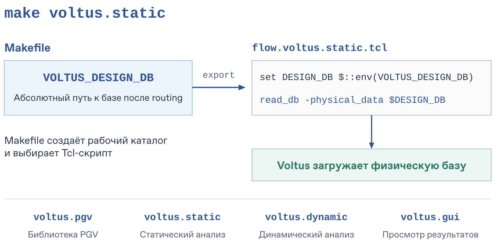

*Рисунок — Как Makefile выбирает скрипт и передаёт ему путь к базе Innovus.*

Например, в блоке **Voltus settings** Makefile переменная `VOLTUS_DESIGN_DB` задаёт путь к базе после routing. Makefile экспортирует её, а `flow.voltus.static.tcl` считывает значение из окружения и использует при загрузке базы.

```tcl
set DESIGN_DB $::env(VOLTUS_DESIGN_DB)
read_db -physical_data $DESIGN_DB
```

Перед первым расчётом запустите `make voltus.pgv`. Цели `voltus.static` и `voltus.dynamic` проверяют наличие готовой библиотеки по пути `VOLTUS_PGV_LIBRARY`. Команда `make -n voltus.static` позволяет посмотреть, какой скрипт и рабочий каталог выберет Makefile для статического расчёта.

### 4.4. Рабочие каталоги

Все команды `make` выполняйте **из корня проекта**. Для структуры каталогов, используемой далее, задайте в Makefile отдельные выходные каталоги.

```makefile
export VOLTUS_PGV_OUTPUT_DIR     = $(VOLTUS_PGV_RUN_DIR)/out
export VOLTUS_STATIC_OUTPUT_DIR  = $(VOLTUS_STATIC_RUN_DIR)/out
export VOLTUS_DYNAMIC_OUTPUT_DIR = $(VOLTUS_DYNAMIC_RUN_DIR)/out
```

| Цель | Рабочий каталог | Основные результаты относительно него |
|---|---|---|
| `voltus.pgv` | `run/voltus.pgv` | `out/pgv/tech_pgv/techonly.cl`, `reports/`, `logs/voltus_pgv.log` |
| `voltus.static` | `run/voltus.static` | `out/static_power/`, `reports/static_rail/`, `logs/voltus_static.log` |
| `voltus.dynamic` | `run/voltus.dynamic` | `out/dynamic_power/`, `reports/dynamic_rail/`, `logs/voltus_dynamic.log` |
| `voltus.gui` | `run/voltus` | `logs/voltus_gui.log` |

Путь `VOLTUS_PGV_LIBRARY` должен указывать на библиотеку в каталоге PGV. Входные файлы и результаты передаются в скрипты абсолютными путями.

### 4.5. Настройки в Makefile

| Переменные | Что указать |
|---|---|
| `VOLTUS_LEF_FILES`, `VOLTUS_QRC_TECH_FILE`, `VOLTUS_LEF_LAYER_MAP` | LEF с технологическим файлом первым, QRC technology и карту слоёв при необходимости |
| `VOLTUS_POWER_PIN`, `VOLTUS_GROUND_PIN` | Имена выводов питания библиотечных ячеек |
| `VOLTUS_FILLER_CELLS`, `VOLTUS_DECAP_CELLS` | Имена специальных ячеек, если они используются |
| `VOLTUS_DESIGN_DB`, `VOLTUS_SPEF_FILE` | Фактические пути к базе и SPEF после routing |
| `VOLTUS_ANALYSIS_VIEW`, `VOLTUS_RC_CORNER` | Имена из MMMC, согласованные с SPEF |
| `VOLTUS_VOLTAGE`, `VOLTUS_TEMPERATURE` | Напряжение и температуру выбранных условий |
| `VOLTUS_IR_DROP_FRACTION` | Порог домена `CORE` в долях номинального напряжения |
| `VOLTUS_POWER_NET`, `VOLTUS_GROUND_NET` | Имена сетей питания проекта |
| `VOLTUS_VDD_PAD_FILE`, `VOLTUS_VSS_PAD_FILE` | Файлы точек подачи VDD и VSS |
| `VOLTUS_INPUT_ACTIVITY`, `VOLTUS_ACTIVITY_PERIOD`, `VOLTUS_CLOCK_GATE_RATIO` | Активность и её нормирование |
| `VOLTUS_TIME_RESOLUTION` | Временное разрешение динамического анализа |
| `VOLTUS_GUI_POWER_DB`, `VOLTUS_GUI_RAIL_STATE`, `VOLTUS_GUI_PLOT` | Power DB, конкретное rail state и начальную карту |

Например, для учебного варианта с view и corner `typ` настройки имеют следующий вид. Проверьте наличие обоих имён в своём MMMC.

```makefile
export VOLTUS_ANALYSIS_VIEW    = typ
export VOLTUS_RC_CORNER        = typ
export VOLTUS_VOLTAGE          = 1.1
export VOLTUS_IR_DROP_FRACTION = 0.02
```

Имена базы и SPEF зависят от implementation-скрипта. Сверьте `VOLTUS_DESIGN_DB` и `VOLTUS_SPEF_FILE` с полученными файлами, включая расширение базы и имя corner в SPEF. Для проверки сформированной команды используйте `make -n voltus.static`.

При разовом запуске параметр можно передать в командной строке.

```bash
make voltus.static VOLTUS_INPUT_ACTIVITY=0.1
```

### 4.6. Точки подачи питания

Для VDD и VSS подготовьте отдельные файлы формата `xy`. Строка содержит имя источника, координаты в мкм и имя слоя. Пример одной строки для VDD выглядит так.

```text
*vsrc_name x y layer_name
vdd_left 5.5 3.5 metal9
```

Координаты и имя слоя возьмите из своей базы. Источник должен попадать внутрь проводника соответствующей сети. В примере раздела 3 используются по две нижние точки для VDD и VSS. Сохраните файлы источников вместе с результатами.

До запуска проверьте восстановление базы, доступность моделей, согласованность view и corner, единицы отчётов и рабочее состояние reset.

<a id="lab5-practice"></a>

## 5. Практические этапы

Команды `bash` выполняйте в терминале Linux, команды `tcl` — в консоли Voltus. Запускайте этапы последовательно в отдельных сеансах. После проверки результата завершайте предыдущий сеанс командой `exit`.

Makefile запускает готовые Tcl-скрипты. Приведённые ниже команды поясняют их работу и помогают просматривать результаты.

<a id="lab5-physical-flow"></a>

### 5.1. Прохождение физического маршрута

1. Выберите дизайн и настройте его входные файлы. Для задания на «4» используйте готовый floorplan преподавателя.
2. Если начинаете с RTL, выполните `make genus.syn`.
3. Запустите `make innovus.fp` с предоставленным вариантом floorplan.
4. Выполните `make innovus.impl`, чтобы пройти placement, CTS и routing.
5. Проведите проверки маршрута, сохраните базу после routing и соответствующий SPEF. Их пути укажите в настройках Voltus.

Перед анализом проверьте, что implementation-скрипт завершил физические операции и записал нужные выходные файлы. Конкретное содержимое этапов определяется выданными Tcl.

<a id="lab5-pgv"></a>

### 5.2. Генерация PGV

Укажите LEF, QRC technology, выводы питания ячеек и при необходимости карту слоёв. Затем выполните генерацию.

```bash
make voltus.pgv
```

В скрипте `read_physical` читает LEF, `set_pg_library_mode` задаёт тип библиотеки, `write_pg_library` создаёт PGV, а `check_pg_library` проверяет результат.

Просмотрите лог и отчёты проверки. Убедитесь, что распознаны слои, выводы питания и все нужные ячейки. Результат находится в `run/voltus.pgv/out/pgv/tech_pgv/techonly.cl`, отчёты — в `reports/`, лог — в `logs/voltus_pgv.log` внутри того же рабочего каталога. Сохраняйте объект `.cl` целиком, включая его содержимое, если инструмент создал каталог.

<a id="lab5-static"></a>

### 5.3. Статический анализ

После настройки базы, SPEF, активности и источников запустите статический расчёт.

```bash
make voltus.static
```

Power analysis восстанавливает проект, распространяет активность и рассчитывает мощность. Rail analysis читает полученные средние токи, задаёт источники и рассчитывает напряжения домена `CORE`.

| Результат относительно `run/voltus.static` | Что проверить |
|---|---|
| `out/static_power/static.rpt` | Единицы, internal/switching/leakage power и итоговую мощность |
| `out/static_power/static_power.db` | Сохранение распределения потребления для GUI |
| `out/static_power/static_VDD.ptiavg`, `static_VSS.ptiavg` | Наличие токов для обеих сетей. Имена зависят от сетей проекта |
| `reports/static_rail/` | Успешный расчёт и созданный каталог состояния |
| `logs/voltus_static.log` | Восстановленную базу, условия и сообщения power/rail analysis |

Запишите фактический путь к **конкретному rail state**. Он потребуется при открытии GUI. При почти нулевой мощности сначала проверьте clocks, активность, reset и библиотеки.

<a id="lab5-debug-threshold"></a>

При ошибке **VOLTUS-1246** проверьте `VOLTUS_IR_DROP_FRACTION` и передачу значения в `set_rail_analysis_domain -threshold`. Если токи уже загружены для текущего проекта, домен и rail analysis можно повторить в открытой сессии.

```tcl
set_rail_analysis_domain -domain_name CORE \
    -power_nets $POWER_NET \
    -ground_nets $GROUND_NET \
    -threshold $IR_DROP_FRACTION

report_rail -output_dir $RAIL_DIR -type domain CORE
```

<a id="lab5-gui"></a>

### 5.4. Просмотр сохранённых результатов в GUI

Для просмотра нужны **физическая база, power DB и rail state одного расчёта**. Укажите их в `VOLTUS_DESIGN_DB`, `VOLTUS_GUI_POWER_DB` и `VOLTUS_GUI_RAIL_STATE`.

Для static power DB находится в `run/voltus.static/out/static_power/static_power.db`. Rail state выбирайте внутри `run/voltus.static/reports/static_rail` по логу успешного `report_rail`.

```bash
make voltus.gui
```

Если `VOLTUS_GUI_RAIL_STATE` пуст, скрипт напечатает найденные `Static states` и `Dynamic states`. Выберите нужный каталог и повторите запуск. Например, если инструмент создал состояние `CORE_125C_avg_1`, используйте следующий путь.

```bash
make voltus.gui \
    VOLTUS_GUI_RAIL_STATE="$PWD/run/voltus.static/reports/static_rail/CORE_125C_avg_1"
```

<a id="lab5-debug-rail-state"></a>

При ошибке **Load Data** проверьте, что указан вложенный каталог состояния. Имя `CORE_125C_avg_1` в примере замените фактическим. Проверьте также соответствие power DB и успешное завершение rail analysis.

В GUI начните с проверки связности, затем откройте потребление, токи и напряжения. Эти представления можно последовательно включить из консоли.

```tcl
gui_set_power_rail_display -plot unc
gui_set_power_rail_display -plot ip
gui_set_power_rail_display -plot tc
gui_set_power_rail_display -plot ir
```

Через **Power & Rail → Power & Rail Plots** и **Layers/Nets** выберите сеть, слои и видимость источников. Проверьте свойства выбранного объекта в **Attribute Viewer**. Порядок разбора карт приведён в [разделе 6](#lab5-results).

<a id="lab5-dynamic"></a>

### 5.5. Знакомство с динамическим анализом

Этот этап ознакомительный. В обязательную часть на «4» входит статический анализ.

1. Согласуйте общие настройки с static и задайте `VOLTUS_TIME_RESOLUTION`.
2. Выполните `make voltus.dynamic`.
3. В логе проверьте clocks и фактический интервал расчёта.
4. Найдите `dynamic.rpt`, `dynamic_power.db` и `dynamic_<net>.ptiavg` в `run/voltus.dynamic/out/dynamic_power`.
5. Для GUI укажите полученную power DB и соответствующий rail state из `run/voltus.dynamic/reports/dynamic_rail`. Запустите `make voltus.gui`.
6. Через **Power & Rail → Dynamic Results → Waveforms** рассмотрите токи и напряжение выбранной ячейки во времени.

Скрипт использует `dynamic_vectorless`, динамический rail analysis и сохранение voltage waveforms. Для объяснения просадки исследуйте выбранную точку и её временную зависимость. Экстремумы разных узлов на общей карте могут возникать в разные моменты времени.

<a id="lab5-results"></a>

## 6. Разбор результатов

### 6.1. Условия и сводка

Для каждого результата запишите проект, базу, версии инструмента и моделей, analysis view, RC corner, напряжение, температуру, активность и точки подачи. Укажите мощность и её составляющие с единицами из отчёта.

### 6.2. Карты потребления и питания

| Карта | Что показывает | Что проверить |
|---|---|---|
| `unc` | Неподключённые узлы | Разрывы и связность питания |
| `ip` | Мощность экземпляров | Где находятся наиболее потребляющие ячейки |
| `tc` | Токи в точках потребления | Распределение нагрузки по блоку |
| `ir` | Результат rail analysis выбранной сети | Величину, единицы, легенду и расположение источников |

На карте различайте потенциал узла и падение относительно номинала. Для VDD падение равно номинальному потенциалу минус локальный. Для VSS рассматривайте подъём относительно земли. Подтверждайте цвет численным значением выбранного объекта.

<a id="fig-lab5-static-map"></a>

> **Скриншот результата добавляется после прогона.** Покажите выбранную сеть, слои, источники, легенду, единицы и исследуемую область. В подписи укажите условия расчёта, а для выбранного объекта — его численное значение.

<a id="lab5-ir-limit-check"></a>

### 6.3. Проверка допустимой просадки

1. Зафиксируйте номинальное питание, предел и его источник. Уточните, относится он к VDD, VSS или VDD−VSS.
2. Для суммарного питания берите VDD и VSS одной ячейки. В динамике также согласуйте время и метрику.
3. Найдите худшее значение среди проверяемых ячеек и сравните с пределом. Для учебных 1,1 В и 2% минимальное VDD−VSS должно быть не ниже **1,078 В**.
4. Сохраните значение, положение объекта и сведения о превышениях. Если численный предел не задан, укажите измеренный результат и это условие.

В учебных скриптах порог домена передаётся через `VOLTUS_IR_DROP_FRACTION` в `set_rail_analysis_domain -threshold`. Значение `0.02` означает принятую долю 2%. Отдельные пороги сетей и бюджет суммарного питания требуют согласованного определения.

### 6.4. Объяснение выбранной области

Выберите область заметной просадки, изучите её нагрузку и расположение относительно источников, полос и переходов. Для выбранной ячейки сопоставьте токи, локальные VDD/VSS и путь подключения. Объясните результат, опираясь на карту и числа.

### 6.5. Типовые ситуации

| Наблюдение | Что проверить |
|---|---|
| Мощность почти нулевая | Clocks, активность, reset и библиотеки |
| Файлы токов отсутствуют | Завершение power analysis, настройки записи и имена сетей |
| [VOLTUS-1246](#lab5-debug-threshold) | Порог домена и передачу `VOLTUS_IR_DROP_FRACTION` |
| [Load Data в GUI](#lab5-debug-rail-state) | Конкретный rail state, power DB и завершение rail analysis |
| Есть неподключённые узлы | Металл питания, переходы, PGV и точки подачи |
| Две карты выглядят одинаково | Численные значения, одинаковые границы шкалы и выбранные состояния |

<a id="lab5-save"></a>

## 7. Сохранение данных

Сохраните данные, позволяющие восстановить условия и повторно открыть результат.

| Материалы | Назначение |
|---|---|
| Makefile и использованные Tcl | Параметры и команды запуска |
| База после routing, SPEF и сведения о моделях | Исходная физическая реализация и условия |
| PGV и отчёты её проверки | Представление библиотек для анализа |
| Файлы точек подачи VDD/VSS | Подключение источников |
| Power report, power DB и токи | Потребление и нагрузка PDN |
| Полный каталог rail state | Карты, отчёты и сохранённые waveforms |
| Логи, скриншоты и выводы | Проверка и объяснение результата |

До `make clean` скопируйте нужные данные **за пределы рабочих каталогов**. Эта цель удаляет рабочие каталоги Voltus. Для экспериментов используйте отдельные места сохранения, например `results/lab5/pdn_a` и `results/lab5/pdn_b`.

После копирования проверьте открытие выбранного результата через GUI. Сохранённая база должна иметь доступ к библиотекам и ограничениям, на которые ссылается.

<a id="lab5-assessment"></a>

## 8. Задания и защита

<a id="lab5-grade4"></a>

### 8.1. Задание на «4»

1. Выберите предоставленный дизайн или совместимый собственный проект. Используйте готовый floorplan преподавателя.
2. Пройдите физический маршрут до routing и выполните его проверки. Сохраните базу и SPEF.
3. Настройте питание, библиотеки и активность. Создайте PGV и проверьте отчёты.
4. Рассчитайте среднюю мощность и статический IR drop.
5. Проверьте исходные условия и связность. Откройте сохранённые результаты в GUI, покажите потребление, токи и напряжения.
6. Объясните выбранную область топологии. При заданном бюджете сравните с ним худший результат.
7. Сохраните материалы и подготовьте краткие выводы.

Исправьте исходные данные, если они делают расчёт недостоверным, и повторите анализ. Обнаруженные электрические нарушения зафиксируйте и объясните. Обязательное достижение конкретной просадки определяется отдельно заданным критерием.

#### Материалы для сдачи на «4»

- [ ] Makefile, использованные Tcl и файлы точек подачи VDD/VSS.
- [ ] Floorplan, база после routing, SPEF и результаты проверок маршрута.
- [ ] Условия анализа и сведения о моделях.
- [ ] PGV, лог генерации и отчёты проверки.
- [ ] Power report, power DB, файлы токов, полный rail state и лог анализа.
- [ ] Скриншоты потребления и напряжений с легендой, единицами и выбранным объектом.
- [ ] Результат проверки связности и объяснение выбранной области.
- [ ] Заданный бюджет и сравнение с измеренным результатом либо отметка, что численный предел не задан.
- [ ] Краткие выводы и возможность повторно открыть результат.

<a id="lab5-main-questions"></a>

#### Основные вопросы для защиты

1. Что рассчитывают power analysis и rail analysis? Какие данные связывают этапы?
2. Почему напряжение на выводе ячейки отличается от напряжения источника?
3. Как ток, сопротивление металла и переходов влияют на IR drop?
4. Чем различаются internal, switching и leakage power?
5. Почему средние токи статического анализа зависят от переключений?
6. Как задаётся активность и откуда берутся clocks?
7. Для чего нужны Liberty, LEF, QRC technology, PGV и SPEF?
8. Что задают точки подачи и как проверить их расположение?
9. Что показывают `unc`, `ip`, `tc` и `ir`? Какие выводы сделаны по вашему проекту?
10. Как получить локальное питание ячейки по VDD и VSS и проверить бюджет?
11. Какие данные нужны для повторного открытия результата в GUI?
12. Как перевести допустимую просадку из процентов в вольты?

<a id="lab5-grade5"></a>

### 8.2. Дополнительное задание на «5»

Выполните базовую часть, затем самостоятельно постройте floorplan по исходному рисунку и сравните **два способа подключения питания**.

#### Исходный floorplan

Для текущего примера используйте технологию **45 нм**, die **75 × 100 мкм**, core **60 × 91 мкм** и четыре боковые шины **M9**. На каждой стороне расположены одна VDD и одна VSS. Длина шины **95 мкм**, ширина **2 мкм**, подача питания снизу. [Исходный рисунок и параметры](#lab5-pdn-inputs).

Самостоятельно создайте области размещения, исходные шины и выводы. Сохраните Tcl и базу. Неуказанные координаты выберите и опишите. Для двух экспериментов используйте одинаковые геометрию, исходные шины и расположение выводов.

#### Вариант A. Подключение M1 к верхним шинам

1. Подключите локальные шины M1 к исходным боковым шинам M9 соответствующей сети через допустимые стеки vias и необходимые участки промежуточного металла.
2. Дополнительную распределённую сетку внутри core в этом варианте не создавайте.
3. Проверьте связность и технологическую корректность питания, завершите маршрут и получите актуальные базу и данные экстракции.
4. Выполните статический power/rail analysis и сохраните результаты варианта A.

#### Вариант B. Питание через сетку

1. На floorplan той же геометрии добавьте горизонтальные M8 и вертикальные M7. Начните с количества и ширины полос из [§3.11](#lab5-pdn-final-view).
2. Соедините сетку с боковыми шинами M9 и локальными M1 через допустимые переходы. Соединения формируйте между проводниками одной сети.
3. Проверьте питание, завершите маршрут и заново получите физическую базу и данные экстракции для изменённой реализации.
4. Выполните статический power/rail analysis и сохраните результаты варианта B.

При сравнении сохраните одинаковыми логический дизайн, размеры die/core, исходные шины, точки подачи, модели, view, напряжение, температуру, clocks и настройки активности. По возможности используйте общий checkpoint placement/CTS. Если маршрут изменил состав ячеек, размещение или нагрузку, укажите различия и их влияние на мощность.

#### Сравнение вариантов

Используйте одинаковые сети, слои, единицы и границы цветовой шкалы. Заполните таблицу по фактическим результатам.

| Показатель | Вариант A | Вариант B |
|---|---|---|
| Способ подключения, слои, ширина и шаг | Заполнить | Заполнить |
| Переходы и результат проверки связности | Заполнить | Заполнить |
| Общая мощность с единицами | Заполнить | Заполнить |
| Максимальное падение VDD, мВ | Заполнить | Заполнить |
| Максимальный подъём VSS, мВ | Заполнить | Заполнить |
| Минимальное VDD−VSS и положение ячейки | Заполнить | Заполнить |
| Бюджет и сравнение с ним | Заполнить | Заполнить |
| Использованный металл и ресурсы трассировки | Заполнить | Заполнить |

Объясните изменение путей доставки тока, распределения напряжений и затрат на питание. Если улучшение небольшое, проверьте числа и условия анализа и объясните полученную разницу. Фиксированная кратность улучшения для оценки не задаётся.

#### Материалы для сдачи на «5»

- [ ] Материалы базовой части.
- [ ] Tcl самостоятельного построения floorplan и исходная база.
- [ ] Tcl питания, базы и актуальные данные экстракции вариантов A и B.
- [ ] Обоснование количества, ширины и шага полос с исходными токами и допущениями.
- [ ] Проверки связности и технологической корректности обоих вариантов.
- [ ] Power/rail reports, состояния, логи и условия обоих расчётов.
- [ ] Таблица сравнения, скриншоты топологий и сопоставимые карты напряжений.
- [ ] Вывод о разнице результатов и затратах на сетку.

<a id="lab5-extra-questions"></a>

#### Дополнительные вопросы для защиты на «5»

1. Какие параметры floorplan заданы и какие выбраны самостоятельно?
2. Как устроено подключение M1 к M9 в варианте A и зачем нужны промежуточные слои?
3. Как соединены M9, M8 и M7 в варианте B? Где устанавливаются переходы?
4. Как ширина, шаг и количество полос влияют на сопротивление и ток каждой полосы?
5. Почему в симметричном примере ток делится между двумя шинами VDD? Как он возвращается по VSS?
6. Почему ток убывает вдоль нагруженной шины и как применяется средний ток участка?
7. Как определить ток через переход M8–M7, питающий соседние участки?
8. Почему после изменения PDN нужны новая экстракция и повторный анализ?
9. Какие условия сравнения сохранены и какие различия появились после маршрута?
10. Какие ресурсы для сигнальной трассировки занимает сетка?
11. Чем статический анализ отличается от динамического?
12. Почему проверка IR drop дополняется проверками связности, DRC и допустимых токов?

<a id="lab5-sources"></a>

## Методическая основа

Исходный floorplan примера 45 нм предоставлен преподавателем. Сопротивления металлов для предварительной оценки взяты из таблицы FreePDK45 и требуют сверки с моделями используемого PDK. [FreePDK45](https://eda.ncsu.edu/freepdk/freepdk45/).

Последовательность PGV, power и rail analysis подготовлена по **Cadence Rapid Adoption Kit — Power and Rail Analysis Using Voltus IC Integrity (Common UI), Voltus 20.10, июль 2020** и учебным Tcl-скриптам.
